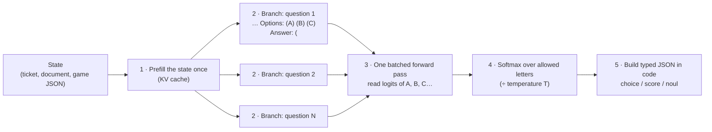

# 4. The inference technique: Jev behaviour from a stock model

This is the family you flagged as interesting, and it is the one that makes a combined
chat + decisions server possible: **the model is not changed**, so it can still chat.

## How it works, in plain terms

When an LLM is about to write the answer to a multiple-choice question, its
next-token probabilities already hold its opinion: some probability on `A`, some on
`B`, and so on. The trick is to stop right there and read those numbers instead of
letting the model write.



Step by step:

1. **Build a prompt per question** that ends exactly where the answer goes, e.g.
   `… Options: (A) billing (B) technical (C) sales  Answer: (`. Give each option a
   one-token code (usually a letter). Turn thinking off.
2. **Process the shared state once.** All questions start with the same state, so it is
   computed once and reused. This is why adding questions is cheap.
3. **Score every question in one batched pass.** Each question is a short branch off
   the shared state. The model runs once and produces next-token scores for each branch.
4. **Keep only the allowed letters** and turn their scores into probabilities
   ("restricted softmax"). Dividing by a fitted temperature `T` fixes over- or
   under-confidence.
5. **Assemble the answer in code:**
   - `choice` = the most likely option, plus all probabilities;
   - `score` = the probability-weighted level;
   - `noul` = P(yes).

Nothing is generated, so the output can never be malformed, and the cost is one
forward pass, not hundreds of generated tokens.

**Why it runs on a normal inference server:** servers like vLLM can return the exact
log-probability of specific tokens (`logprob_token_ids` in vLLM). Log-probabilities
differ from raw scores only by a constant, so renormalising them over the allowed
letters gives the same distribution. So the trick can run as a small program *next to*
a standard server, instead of inside a custom engine.

## How much does it cost in speed?

Measured on an RTX PRO 6000 (your card) by
[openvons](https://github.com/genai-craft/openvons), stock Qwen3-4B on vLLM,
short state:

| Questions per request | Letter-read via vLLM (ms, p50) | Generating JSON via vLLM (ms, p50) |
|---|---|---|
| 1 | 10.6 | 64.6 |
| 4 | 20.6 | 254 |
| 16 | 40.2 | 895 |

For the 27–31B entries the index measured ~85–110 ms median per request on the same
card (simple-jev was slower at 373 ms).

## The projects

Scores are from the Decision Index 0.2.1 (Jev = 57.9). "Sidecar" means the project
does not load the model itself: it talks to a standard vLLM or SGLang server, which
can also serve chat.

| Project | Score | Model tested | Engine | Sidecar? | API | Calibration | Max options | Licence |
|---|---|---|---|---|---|---|---|---|
| [Mapika/decider](https://github.com/Mapika/decider) ("Decider chat") | **57.3** (Gemma 4 31B) / 51.4 (Qwen3.6-27B) | stock instruct models | HF transformers, or vLLM in-process | No | `/v1/systemone` | Fitted T (Qwen3.6-27B: 1.943) | 255 | Apache-2.0 |
| [featherless-ai/simple-jev](https://github.com/featherless-ai/simple-jev) | 55.7 | Qwen3.8-27B | HF transformers, one request at a time | No | `/v1/classifier` (+ `systemone` alias, "inspired by") | None | 255 | Apache-2.0 |
| [kshetrajna12/reflex](https://github.com/kshetrajna12/reflex) | 52.2 | Qwen3.8-27B-FP8 | transformers, or **SGLang sidecar** | Yes (SGLang) | `/v1/systemone` | Two option orders averaged + optional T | 26 | MIT |
| [kikoncuo/jevfire](https://github.com/kikoncuo/jevfire) | 49.4 | Qwen3.8-27B-FP8 | **vLLM sidecar** | Yes (vLLM) | `/v1/decisions` (own format, no `score`) | T parameter | 255 | MIT |
| [ekzhang/openjev-sglang](https://github.com/ekzhang/openjev-sglang) | not ranked | Qwen3.6-35B-A3B | **SGLang sidecar** | Yes (SGLang) | `/v1/systemone` | None | 64 | none (no licence file) |
| [genai-craft/openvons](https://github.com/genai-craft/openvons) | 28.4 | Qwen3-4B | **vLLM sidecar** | Yes (vLLM) | `/v1/systemone` | Optional T | 26 | Apache-2.0 |
| [zhengxuyu/litjev](https://github.com/zhengxuyu/litjev) | not ranked | Qwen3.8-27B | HF transformers | No | `/v1/systemone` (exact) | Optional T file | 255 | Apache-2.0 |
| [MantisShrimpdev/jobe](https://github.com/MantisShrimpdev/jobe) | 32.4 | Qwen3.5-4B | HF transformers | No | `/v1/systemone` | None | 16 | MIT |
| [TheoLeeCJ/openjev](https://github.com/TheoLeeCJ/openjev) ("SemIf") | 25.9 | Qwen3.5-4B | CUDA, MLX, llama.cpp, WebGPU | No | CLI only | Per-workload T | 16 | MIT |
| [Micha0827/snapjudge](https://github.com/Micha0827/snapjudge) | not ranked | Qwen3.8-27B / 3.6-35B | MLX (Mac only) | No | `/v1/systemone` | — | trie | MIT |
| [harshatheg/Qwen-2.5-1B-RLCD](https://huggingface.co/harshatheg/Qwen-2.5-1B-RLCD) (the viral one) | 3.8 | Qwen2.5-1.5B | MLX / torch | No | own | fake (clamped) | broken on shared prefixes | Apache-2.0 |

**Pattern:** the technique only works well on big models. At ~27–31B it ties Jev on the
benchmark. At 4B it scores 26–32, well behind 4B *trained* models (~40).

## What goes wrong, and the fixes people found

| Problem | What happens | Fix |
|---|---|---|
| **Miscalibration** | A stock 7B was >90% confident on 13 of its 20 wrong answers | Fit a temperature per workload or question type on labelled data. Cuts ECE ~3× (e.g. 0.208 → 0.069). No single temperature works for all tasks. |
| **Labels that aren't one token** | Options like `P1_HIGH` / `P1_CRITICAL` share a first token, so the read is ambiguous | Map options to single-token letters (A, B, …, AA…) and check each is one token *in context* at startup |
| **Option order** | Reordering options flips 2–23% of answers | Averaging two orders helped reflex (ECE 0.086 → 0.081) but not jobe; measure on your data |
| **No "none of the above"** | The model must pick something (p = 0.998 on a nonsense request) | Add an explicit NONE option; check how much probability landed on allowed letters |
| **Too many options** | Letters run out at 16–26 in several projects | Two-letter codes up to 255, or ask in two stages (narrow, then pick) |
| **Long documents** | Cross-checking 8k-token invoices: stock 27B 38/75 vs Jev 65/75 | Bigger model; put questions before the state for long documents; fall back to a chat/thinking call |
| **bf16 rounding** | Near-ties flip; looks like position bias | Compute the few candidate logits in fp32 |
| **Thinking models** | First token is `<think>`, not the answer | `enable_thinking=False` in the chat template |

Two useful rules of thumb from the studies:

- **Letters vs option names:** [mini-jev](https://github.com/r-ms/mini-jev) found reading a
  letter beats scoring the option name by ~10 points on Qwen3-4B;
  [jevmlx](https://github.com/bnsd55/jevmlx) found the reverse on Qwen3-8B. Test both on
  your model.
- **Confidence as a gate:** falling back to a slower chat/thinking call only helps at a
  low threshold (jobe: <0.45 helped, 0.57 hurt).

## How to run one today

Quickest, on your GPU, chat and decisions from one model: jevfire over vLLM. The
command below is adapted from jevfire's own RTX PRO 6000 setup, which used
`--gpu-memory-utilization 0.45 --max-model-len 16384 --max-num-seqs 64`; the
benchmark run used 0.9 utilisation.

```bash
# 1. The model server (also serves /v1/chat/completions)
vllm serve Qwen/Qwen3.8-27B-FP8 --served-model-name qwen3.8-27b \
  --host 127.0.0.1 --port 8000 --gpu-memory-utilization 0.9 \
  --max-model-len 32768 --kv-cache-dtype fp8 --reasoning-parser qwen3 \
  --enable-prefix-caching --language-model-only

# 2. The decisions sidecar (CPU only, no second copy of the model)
git clone https://github.com/kikoncuo/jevfire && cd jevfire && pip install -e '.[dev]'
DECISION_VLLM_URL=http://127.0.0.1:8000 DECISION_MODEL=qwen3.8-27b \
DECISION_TOKENIZER=Qwen/Qwen3.8-27B-FP8 \
  python -m uvicorn jevfire.app:app --host 127.0.0.1 --port 8010
```

This gives chat on `:8000` and decisions on `:8010/v1/decisions`. The catch: jevfire's
API is its own format, not Jev's `/v1/systemone`, and has no `score` type.

For a Jev-compatible endpoint with the best accuracy, see
[5-combined-server.md](5-combined-server.md).
