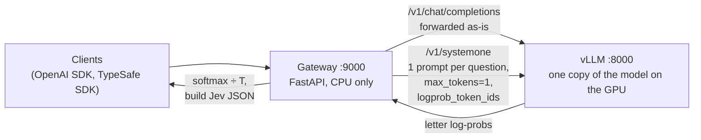

# 5. One server for chat and Jev-like decisions

**Short answer:** yes, this works on your single RTX PRO 6000 (96 GB). No project does it
exactly out of the box yet. The cleanest design is:

- **one vLLM process** that owns the model and serves normal chat;
- **a small CPU-only gateway** in front that adds a Jev-compatible `/v1/systemone`
  endpoint using the inference technique from [doc 4](4-inference-technique.md).

Your model is unchanged, so chat quality is exactly the stock model's. Decision
quality on a ~30B model is close to Jev on the community benchmark.

## Why one model can do both

Chat and decisions are just two ways of calling the same model:

| | Chat | Decision |
|---|---|---|
| Request | normal `/v1/chat/completions` | `/v1/completions` with `max_tokens: 1` and `logprob_token_ids: [ids of A, B, C…]` |
| Model work | generate many tokens | one forward pass per question |
| Result | text | probabilities of the answer letters |

vLLM schedules both kinds of request together on the same GPU. Its prefix cache means
the shared state is processed once, even when each question is a separate prompt.



## Your options, compared

Decision scores are from the Decision Index 0.2.1 (Jev = 57.9).

| Option | Decisions (score) | Jev wire format? | Chat quality | Effort | Verdict |
|---|---|---|---|---|---|
| **A. vLLM + stock Qwen3.6-27B + custom gateway** | 51.4, ECE 0.021 (published temperature) | Yes | Full Qwen3.6-27B | Small app | **Recommended start** |
| **A′. Same with stock Gemma 4 31B** | 57.3 (ties Jev; see caveat) | Yes | Full Gemma 4 31B | Small app + fit temperature | **Upgrade path** |
| B. vLLM + [jevfire](https://github.com/kikoncuo/jevfire) sidecar | 49.4 | No (`/v1/decisions`, no `score`) | Full Qwen3.8-27B | None | Quickest proof of concept |
| C. [surogate](https://github.com/invergent-ai/surogate) + [Rune v3](https://huggingface.co/surogate/rune-26b-a4b-GGUF) (trained) | 57.4 | Almost (`/v1/decisions`, same fields; needs a path alias) | Rune's chat, not measured | Low | Strong, but young engine, CUDA 13 only |
| D. [winnow-inference](https://github.com/EldanRing/winnow-inference) + Winnow-12B (trained) | 50.0, ECE 0.168 | Yes | Gemma 4 12B-based | Turnkey | Small and simple; poorly calibrated |
| E. [razorback16/openjev](https://github.com/razorback16/openjev) (diffusion) | 37.3, ECE 0.23 | Yes | DiffusionGemma (weaker) | Turnkey Docker | Fastest, least accurate |
| F. SGLang + [reflex](https://github.com/kshetrajna12/reflex) or [openjev-sglang](https://github.com/ekzhang/openjev-sglang) | 52.2 (reflex) | Yes | Full | Low | **Avoid for now:** SGLang can crash on mixed chat + decision traffic ([#34719](https://github.com/sgl-project/sglang/issues/34719), open) |

Options C–E are good if you want something running today with no code. Option A gives
the best mix of chat quality, decision quality, calibration and control.

## Recommended build (option A)

### 1. Pick the model

| Model | Weights (bf16) | Left for KV cache at 90% | Decision score | Temperature |
|---|---|---|---|---|
| `Qwen/Qwen3.6-27B` | ~56 GB | ~30 GB | 51.4 | **1.943, published** by decider |
| `google/gemma-4-31B-it` | ~65 GB | ~21 GB | 57.3 | Not published; fit your own |

Start with Qwen3.6-27B, because its temperature is already known and validated
(ECE 0.021). Move to Gemma 4 31B once your calibration pipeline works. Caveat: its 57.3
came from an unreleased research server, so expect to reproduce it rather than get it
for free.

Stay in bf16 at first. Quantisation changes the answers slightly: FP8 flipped ~1% of
decider's answers, and NVFP4 made reflex's calibration ~50% worse. Refit the
temperature after any change of model, precision or prompt.

### 2. Start vLLM

```bash
vllm serve Qwen/Qwen3.6-27B --served-model-name qwen3.6-27b \
  --host 127.0.0.1 --port 8000 \
  --enable-prefix-caching --gpu-memory-utilization 0.90 \
  --max-model-len 32768 --reasoning-parser qwen3 \
  --language-model-only        # skip the vision tower; drop this for image chat
```

Rules for the shared server:

- **No speculative decoding / MTP.** It can crash vLLM together with
  `logprob_token_ids` ([#42592](https://github.com/vllm-project/vllm/issues/42592), open).
- vLLM caps `logprob_token_ids` at **128 ids** per request. For questions with more
  than 128 options, split them, or apply jevfire's
  [one-line patch](https://github.com/kikoncuo/jevfire) that raises it to 256.
- Chat clients that request `top_logprobs` may get wrong logprob *values* when batched
  with decision requests ([#51789](https://github.com/vllm-project/vllm/pull/51789), open).
  The generated text is unaffected. Most chat clients don't ask for logprobs.

### 3. Write the gateway

A small FastAPI app. For `/v1/chat/completions` and `/v1/models` it forwards the
request to vLLM unchanged. For `/v1/systemone` it:

1. **Validates** the request. Return `422` for anything over your limits, never `500`.
2. **Builds one prompt per question** in decider's "chat layout": the model's own chat
   template, thinking off, state first, then question and lettered options, ending at
   `Answer: (`. Reuse decider's prompt builder (`pip install --no-deps decider-ai`,
   `decider.serve.prepare`) instead of writing your own.
3. **Scores all questions in one call** to vLLM (below).
4. **Turns scores into probabilities:** `softmax(logprob / T)` over each question's letters.
5. **Builds the Jev response:** `choice` = top option; `score` = probability-weighted
   level; `noul` = P(yes) as a float, with no confidence; `usage.output_tokens` = 0.
   Compute `confidence` with TypeSafe's formulas: `(p_max − 1/K) / (1 − 1/K)` for choice
   and the mode-distance formula for score. decider's code already does this; most
   other projects don't (see [doc 6](6-answer-compatibility.md)).

The core scoring call, adapted from jevfire's
[`core.py`](https://github.com/kikoncuo/jevfire) (a sketch, not tested):

```python
import math


async def score(client, tokenizer, model, prompts, letter_ids, n_options, T):
    """prompts: one rendered prompt per question, each ending at the answer slot.
    letter_ids: token ids of A, B, C… (check each is ONE token in context at startup).
    n_options: number of options for each question."""
    r = await client.post(
        "/v1/completions",
        json={
            "model": model,
            "prompt": [tokenizer.encode(p, add_special_tokens=False) for p in prompts],
            "max_tokens": 1,
            "temperature": 0,
            "logprobs": 0,
            "logprob_token_ids": letter_ids[: max(n_options)],  # max 128 in stock vLLM
            "return_tokens_as_token_ids": True,
            "add_special_tokens": False,
        },
    )
    r.raise_for_status()
    results = []
    for choice, n in zip(sorted(r.json()["choices"], key=lambda c: c["index"]), n_options):
        lp = choice["logprobs"]["top_logprobs"][0]
        scores = [lp[f"token_id:{i}"] for i in letter_ids[:n]]
        top = max(scores)
        w = [math.exp((s - top) / T) for s in scores]
        results.append([x / sum(w) for x in w])
    return results
```

Guards that every serious project ended up adding:

- At startup, check each letter is a single token *in context*:
  `encode(prompt + "A") == encode(prompt) + [id_A]`.
- Run one warm-up decision before accepting traffic.
- Log every decision (request hash, probabilities) to a JSONL file for later calibration.
- Offer an explicit "none of the above" option when your use case needs one.

Want one process instead of two? vLLM's `--middleware` flag can load your handler
inside `vllm serve` itself. It can then call the engine directly through
`app.state.engine_client`. Nobody ships this yet; start with the separate gateway.

### 4. Calibrate on your own data

Raw probabilities from a stock model are often overconfident. To fix that:

1. Collect a few hundred decisions from **your** workload with correct labels. Do **not**
   use Jev's answers as labels: TypeSafe's terms forbid it (see [doc 1](1-what-is-jev.md)).
2. Fit a temperature per question type with `python -m decider.calibrate` (from
   `decider-ai`).
3. Re-check calibration error (ECE) on held-out data. Refit whenever you change the
   model, precision or prompt.

Use confidence as a gate, not as truth. For example, send low-confidence decisions
(below ~0.45) to the same model in chat or thinking mode, or to a human.

### 5. Test it

- **Compatibility:** point the official SDK at your gateway
  (`TYPESAFE_BASE_URL=http://localhost:9000`) and run the
  [quickstart example](https://docs.typesafe.ai/introduction/quickstart).
- **Quality:** use TypeSafe's public example cases (rebuilt as 373 decisions by
  [jev-on-a-laptop](https://github.com/rorshopping/jev-on-a-laptop)) or the
  [Decision Index harness](https://github.com/apolinario/decision-index) to compare
  with the published numbers.
- **Mixed load:** run chat and decision traffic at the same time and watch for errors
  and latency spikes.

## Later: add a trained decision adapter

If the stock model isn't accurate enough, add a decision **LoRA** that vLLM applies
only to decision requests. Chat keeps using the plain model. Caveats:

- Few strong LoRAs are published unmerged. Bespoke Nimble 9B v2 is one, but it is weak
  (39.6). Jebadiah 27B (54.7) was trained as a LoRA on the public Qwen3.8-27B, but only
  the merged weights are published.
- vLLM LoRA can silently do nothing on Qwen3.5/3.6-family models
  ([#49354](https://github.com/vllm-project/vllm/issues/49354), open). Gemma 4 is
  reported to work. Always check that the adapter actually changes the log-probs.
- Training your own is realistic. Kev-4B trains in ~40 minutes on one H100, and
  Together AI's [Tev1 recipe](https://www.together.ai/blog/how-to-train-your-own-jev)
  cost ~$17.
