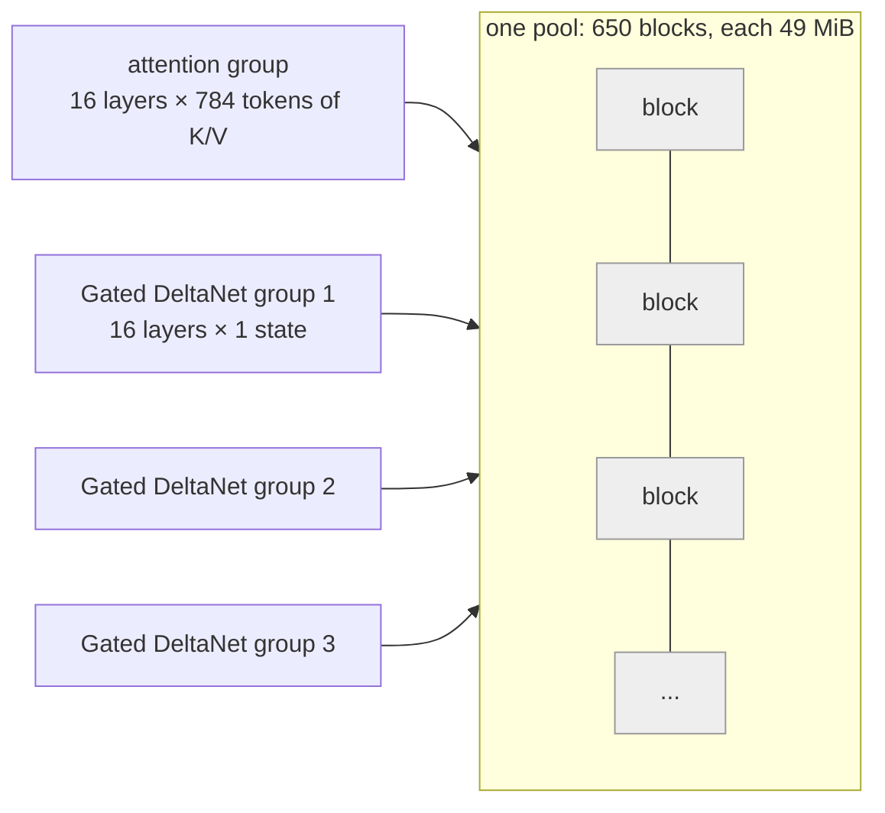

# KV caches, in general and in vLLM

What a KV cache holds, how vLLM v0.30.0 stores, shares and evicts it, and what that means
for our three profiles. The model-specific numbers come from
[model-architectures.md](model-architectures.md), our startup logs and bench runs; vLLM
behaviour is read from the v0.30.0 source (paths below are `vllm/...` at that tag). Units:
1 KiB = 1,024 bytes, 1 MiB = 1,024 KiB, 1 GiB = 1,024 MiB.

## Short answer

- **K and V are each token's "address" and "content" for attention.** Every attention layer
  computes them once per token and keeps them, so a new token only computes its own and reads
  the rest. That is the KV cache. Without it, every decode step would redo the whole prompt.
- **Cost per token = 2 × KV heads × head dim × bytes, per attention layer.** Qwen3.6/3.8:
  64 KiB per token (16 attention layers), plus ~147 MiB of fixed recurrent state per request.
  Gemma 4 31B: 880 KiB per token until its 1,024-token window fills, then 80 KiB.
- **vLLM stores KV in fixed-size blocks** (PagedAttention), like pages in virtual memory. A
  per-request block table maps token positions to blocks in one shared pool.
- **Freed blocks stay cached until they are reused.** The free list is LRU-ordered: a freed
  block keeps its hash and can still be hit, and is only evicted when it is handed out again.
  vLLM's "KV cache usage" counts only blocks held by running requests.
- **Prefix caching works on whole blocks.** Each full block gets a hash of its tokens chained
  to its parent's hash. A hit is the longest run of matching blocks from the start, so hits
  are block-granular, and the last prompt token is always computed.
- **One pool for mixed layers.** vLLM makes every layer type's page the same size. On hybrid
  Qwen, one Gated DeltaNet state (3.06 MiB) sets the attention block at **784 tokens**; with
  MTP on (3 draft tokens) the state grows and the block becomes **800 tokens** (§6).
- **"Align" mode** saves recurrent state only at block boundaries, and by default keeps only
  the last one before the prompt ends. That is why Qwen prefix hits come in 784-token steps.
- **fp8 KV halves attention memory** but moves logprobs (refit), coarsens Qwen blocks to
  1,568 tokens, and is reported to corrupt output with MTP on sm_120 (#49010).
- **Gemma is KV-bound, Qwen is not.** Gemma's pool fits one ~144k-token prompt; vLLM's logged
  "KV cache size" is a max-length-request count, so it moves with `max_model_len` (DS-026).
- **Chunked prefill touches the cache too.** On hybrid Qwen, prefill chunks are cut so they
  end on block boundaries. When the per-request chunk cap (784) is smaller than the block
  (800 with MTP), a prompt needs an extra short step (§9).

## 1. What K and V are, and why decode needs them

In each attention layer, every token is projected into three vectors:

- **query (Q):** what this token is looking for;
- **key (K):** what this token offers, matched against later tokens' queries;
- **value (V):** what this token contributes when it is attended to.

Token *t*'s output is a weighted sum of the values of tokens 1…*t*, with weights
softmax(Q_t · K_i / √d). Causal attention means K_i and V_i of an earlier token never change
once computed: later tokens only read them.

```
prefill (prompt of n tokens):  compute Q, K, V for all n at once -> write n K/V rows per layer
decode step (token n+1):       compute Q, K, V for 1 token -> append 1 K/V row, read all n+1
```

- **Without a cache,** each decode step would recompute K and V for the whole prefix: work
  that grows with the length at every step.
- **With a cache,** a decode step does a fixed amount of new work per layer and reads the
  stored rows. This read is why decode is memory-bandwidth-bound
  ([prefill-and-decode.md §1](prefill-and-decode.md)).
- **Grouped-query attention (GQA)** shares each K/V head among several query heads. Qwen has
  24 query heads but 4 KV heads; only the 4 are cached.
- **Layers that are not attention** keep something else. A sliding-window layer keeps only
  the last *W* tokens' K/V. A recurrent layer (Gated DeltaNet) keeps one fixed-size state
  that it overwrites each token
  ([speculative-decoding-and-mamba.md §2](speculative-decoding-and-mamba.md)).

## 2. Memory per token, and per request

For one attention layer: **2 (K and V) × KV heads × head dim × bytes per element**. Our
models in bf16 (2 bytes), configs from [model-architectures.md §2](model-architectures.md):

| | Arithmetic | Result |
|---|---|---|
| Qwen attention, per token | 2 × 4 × 256 × 2 B = 4 KiB per layer × 16 layers | **64 KiB** |
| Qwen Gated DeltaNet state, per layer | matrix: 48 × 128 × 128 × 4 B (fp32) = 3 MiB; conv: (16·128·2 + 48·128) channels × 3 × 2 B = 60 KiB | **3.06 MiB** (3,207,168 B) |
| Qwen state, per request | 3.06 MiB × 48 layers | **~147 MiB**, whatever the length |
| Gemma sliding window, per token | 2 × 16 × 256 × 2 B = 16 KiB × 50 layers | **800 KiB**, only for the last ~1k tokens |
| Gemma full attention, per token | 2 × 4 × 512 × 2 B = 8 KiB × 10 layers | **80 KiB**, for every token |

- **The Gated DeltaNet state** is a d_k × d_v matrix per value head, kept in fp32 because the
  config's `mamba_ssm_dtype` asks for it, plus a short convolution's last 3 inputs
  (`vllm/model_executor/layers/mamba/mamba_utils.py:274-295`).
- **One of our largest systemone rows (2,541 tokens):** Qwen 2,541 × 64 KiB + 147 MiB ≈
  **306 MiB**; Gemma 2,541 × 880 KiB ≈ **2.1 GiB**, about 7× Qwen, since the whole row is
  inside the window while it prefills.
- **With MTP on,** the drafter adds one full-attention layer with its own KV
  (`vllm/model_executor/models/qwen3_5_mtp.py:119-125`), and the recurrent state grows (§6).

## 3. Paged attention: blocks and block tables

Before vLLM, servers reserved one contiguous KV region per request, sized for the longest
possible output. The PagedAttention paper measured that only 20.4–38.2% of that memory held
real token states; the rest was reserved or fragmented.

vLLM's fix borrows from operating systems: "one can think of blocks as pages, tokens as
bytes, and requests as processes" (Kwon et al., §4.1).

- **Block:** a fixed number of tokens' K/V for one layer group (16 tokens by default in the
  paper; 784 on hybrid Qwen, §6).
- **Block table:** each request's list of block ids, mapping logical token positions to
  physical blocks. Blocks need not be contiguous.
- **On-demand allocation:** a request takes a new block only when its last one is full, so at
  most one partly-filled block per request (per group) is wasted.
- **Sharing:** a block can appear in several block tables, with a reference count. This is
  what makes prefix caching (§5) cheap: a hit just adds the cached block to the new
  request's table.

```
request A table: [ 7 ][ 2 ][ 9 ]          pool: | 0 | 1 | 2 | 3 | 4 | 5 | 6 | 7 | 8 | 9 | ...
request B table: [ 7 ][ 2 ][ 4 ]                        ^A,B      ^B          ^A,B      ^A
                 shared prefix = blocks 7, 2 (ref count 2)
```

The paper's trade-off on block size: too small under-uses the GPU's parallelism, too large
wastes the partly-filled last block (§7.2). On hybrid Qwen the size is forced by the
recurrent state instead (§6).

## 4. The block pool: allocation, freeing, eviction

At startup vLLM profiles memory, subtracts weights and activations from
`--gpu-memory-utilization` × GPU memory, and divides the rest into blocks. On Qwen3.6 that
was 650 blocks of 49 MiB (31.1 GiB) on 2026-10-06 ([arm A](../results/ds-004/qwen3.6-27b/runs/A/summary.md)),
665 or 638 on earlier startups; the count moves with free memory at startup.

`BlockPool` (`vllm/v1/core/block_pool.py:143-161`) keeps:

- a **free queue**, a doubly linked list in eviction order (`vllm/v1/core/kv_cache_utils.py:246-266`);
- a **hash → block map** of every block that still holds a cached prefix.

| Event | What happens | Source |
|---|---|---|
| Allocate | Pop from the head of the free queue. If the popped block still has a hash, drop it from the map now: this is the eviction | `block_pool.py:664-697`, `726-747` |
| Prefix hit | "Touch" the cached block: remove it from the free queue if it was there, ref count + 1 | `block_pool.py:749-764` |
| Request finishes | Ref count − 1. At 0, a block **without** a hash goes to the head (reused first); a block **with** a hash goes to the tail (LRU) | `block_pool.py:770-800` |
| Order of freeing | A request's blocks are freed in reverse, so its tail blocks sit nearer the head and are evicted before its shared prefix | `single_type_kv_cache_manager.py:581` |
| Out of blocks | The scheduler preempts a running request (lowest priority, or the last admitted under FCFS) and recomputes it later | `vllm/v1/core/sched/scheduler.py:745-753` |

Two consequences:

- **"KV cache usage" is not cache contents.** `get_usage()` is 1 − free ÷ total
  (`block_pool.py:869-880`), and cached-but-unreferenced blocks count as free. Our "KV peak
  12%" ([prompt-sharing.md §3](prompt-sharing.md)) means blocks held by running requests;
  the prefix cache can fill the rest.
- **Eviction is lazy and LRU.** A cached prefix survives until the pool runs through every
  block freed after it. With 650 blocks and ~13 requests running, popular prefixes live long.

## 5. Prefix caching: hashes and hits

**Hashing.** Each *full* block gets
`hash(parent block's hash, this block's token ids, extra keys)`
(`vllm/v1/core/kv_cache_utils.py:638-668`). Extra keys cover things like LoRA ids, image
hashes and cache salts. Because each hash includes its parent, a block hash stands for the
whole prefix up to that block, not just its own tokens.

**Lookup** (`vllm/v1/core/single_type_kv_cache_manager.py:744-838`, full attention):
1. Walk the new request's block hashes from the start; stop at the first miss. Later blocks
   can't match either, since their hashes chain through the missed one.
2. The hit length is matched blocks × block size.
3. The lookup is capped at `num_tokens − 1` (`vllm/v1/core/kv_cache_manager.py:295`), so even
   a fully cached prompt computes its last token: the model needs that position's output.

**What a "hit" is in our metrics:** `vllm:prompt_tokens_cached_total` counts prompt tokens
served from cached blocks; computed tokens = prompt − cached
([prompt-sharing.md §3](prompt-sharing.md)).

**Why hits are block-granular:**
- only full blocks are hashed, so a shared prefix of 2,064 tokens with 784-token blocks
  reuses 2 × 784 = 1,568 and the remaining 496 are recomputed
  ([prompt-sharing.md §2](prompt-sharing.md));
- on hybrid Qwen there is a second reason: recurrent state exists only where it was saved
  (§6).

**When a block becomes hittable** depends on the layer type:
- full-attention blocks are hashed as they fill, so rows sent together in one call can
  share, as Gemma does with `--prefix-cache-retention-interval 32`
  ([prompt-sharing.md §7](prompt-sharing.md));
- Mamba state blocks written by another request in the same step are refused: the
  scheduler postpones the request to the next step instead
  (`single_type_kv_cache_manager.py:1726-1733`). That is one reason Qwen sends a warm-up row
  first.

## 6. Mixed layer types in one pool

vLLM's hybrid KV cache manager keeps **one pool with one page size**. It groups layers of the
same type into groups of equal layer count (the smallest type's count: 16 for Qwen, 10 for
Gemma), and every group draws block ids from the same pool
(`vllm/v1/core/kv_cache_utils.py:1435-1575`).



| Layer type | What one page holds | How a hit is checked |
|---|---|---|
| Full attention | `block_size` tokens of K/V for one layer | Longest run of matching blocks from the start (§5) |
| Sliding window | the same, but blocks older than the window are freed | Only the last *W* − 1 tokens before the hit must still be cached |
| Recurrent (Mamba, Gated DeltaNet) | **one whole state**, not per token | A saved state at the exact hit position; searched right to left (`single_type_kv_cache_manager.py:1538-1557`) |

### Why hybrid Qwen blocks are 784 tokens

A recurrent state can't be split by token, so the attention block grows until one attention
page is at least one state page, in multiples of the attention kernel's block alignment (16)
(`vllm/platforms/interface.py:922-926`); the state page is then padded to match
(`interface.py:942-962`):

| Setting | State page | Attention block | Pad |
|---|---|---|---|
| Shipped (bf16 KV, fp32 state) | 3,207,168 B | 16 × ⌈3,207,168 ÷ (16 × 4,096)⌉ = **784** (logged) | 4,096 B, 0.13% (logged) |
| **MTP on, 3 draft tokens** | 3,145,728 + 10,240 × 6 × 2 = 3,268,608 B | 16 × ⌈49.9⌉ = **800** (logged: "571 blocks × 800 tokens") | 8,192 B, 0.25% (formula) |
| fp8 KV (2 KiB per token per layer) | 3,207,168 B | **1,568** (formula) | |
| bf16 state (`--mamba-ssm-cache-dtype bfloat16`) | 1,634,304 B | **400** (formula) | |

- **Why MTP changes it:** with speculative decoding the convolution state keeps the last
  `kernel − 1 + K` inputs instead of `kernel − 1` (3 + 3 = 6 here), so the state's conv part
  doubles (`mamba_utils.py:284-288`, K passed in by `vllm/model_executor/models/qwen3_5.py:405-418`).
  The matrix part is unchanged.
- **One block = one page × 16 layers:** 49 MiB at 784 tokens, 50 MiB at 800.
- **The gateway still pads to 784** (`prefix_block: 784` in the MTP arms' provenance). That
  is right with MTP off and misaligned with MTP on (see
  [speculative-decoding-and-mamba.md §3c](speculative-decoding-and-mamba.md)).

### "Align" mode: when recurrent state is saved

With prefix caching on, vLLM sets `mamba_cache_mode = "align"` for hybrid models and sets
`mamba_block_size = block_size`, overriding any `--mamba-block-size`
(`vllm/model_executor/models/config.py:622-656`, `interface.py:939-940`). In align mode:

1. **Prefill chunks are cut so state lands on block boundaries.** The scheduler clips each
   chunk so it ends on a multiple of the block size, and never runs past the last boundary
   before the prompt's end (`scheduler.py:413-526`).
2. **The kept checkpoint is the last boundary before the prompt ends:**
   ⌊(n − 1) ÷ B⌋ × B for an n-token prompt, or one block lower with EAGLE/MTP's block drop
   (`vllm/v1/kv_cache_interface.py:1073-1082`).
3. **Earlier states are dropped by default.** `--prefix-cache-retention-interval` defaults to
   0: "retains only semantic checkpoints, including the latest replay boundary and
   shared-prefix junctions" (`vllm/config/cache.py:148-154`).
4. **A running request holds 2 state pages per group** (the previous chunk's and the one being
   written), plus K more with speculative decoding
   (`kv_cache_interface.py:1035-1045`; K from `vllm/model_executor/layers/mamba/abstract.py:81-85`).

```
prompt of 2,832 tokens (padded shared part 2,352 + one question 480), B = 784
|---- 784 ----|---- 784 ----|---- 784 ----|-- 480 --|
                                          ^ checkpoint kept: ⌊2,831 ÷ 784⌋ × 784 = 2,352
                                            = end of the padded shared part, so siblings resume here
```

That is the mechanism behind DS-008's front padding and the row warm-up
([prompt-sharing.md §6-§7](prompt-sharing.md)): padding puts the shared part's end exactly on
the last boundary of row 1.

**Gemma's groups:** 6 groups (5 sliding + 1 full, 10 layers each; our estimate from the
grouping rule). A full-attention page per token is half a sliding page, so the full block is
doubled to keep pages equal: 32 tokens vs 16, if the backend default is 16
(`kv_cache_utils.py:1365-1427`). With no recurrent layers, hits can land on any 32-token
boundary (estimate).

## 7. KV dtype: bf16 vs fp8

`--kv-cache-dtype auto` (our setting) stores K/V in the model dtype, bf16
(`vllm/config/cache.py:111-115`). The recurrent state has its own knobs:
`--mamba-cache-dtype` and `--mamba-ssm-cache-dtype` (`cache.py:170-177`).

| | fp8 KV effect | Status |
|---|---|---|
| Gemma 4 31B | Every attention page halves (880 → 440 KiB per token), so capacity should roughly double (estimate) | DS-005; needs a drift check and a refitted temperature ([calibration.md §7](calibration.md)) |
| Hybrid Qwen | Attention page halves but the fp32 state doesn't, so the block doubles to 1,568 tokens (formula): coarser sharing, and Qwen isn't short of memory | Only hurts, unless the state shrinks too |
| Any profile with MTP | #49010: fp8/nvfp4 KV with MTP corrupts output on sm_120 (our GPU) | DS-004 keeps the KV cache bf16 |

## 8. `max_model_len` vs KV capacity

vLLM's startup line `GPU KV cache size: N tokens` is **not** a count of token slots. It is
blocks in the pool ÷ blocks one maximum-length request would need × `max_model_len`
(`vllm/v1/core/kv_cache_utils.py:1067-1100`).

**Qwen3.6, startup log of 2026-09-28** (`max_model_len` 32,768 then; the profile now uses
262,144):
- one 32,768-token request needs ⌈32,768 ÷ 784⌉ = 42 attention blocks plus 3 groups × 2
  state pages = 48;
- 665 ÷ 48 = 13.85×, × 32,768 = **453,973**, as logged.

**Gemma 4 31B (DS-011, DS-026).** Each sliding group reserves the window plus every prefill
chunk still in flight: with async scheduling 2 × 8,192 tokens, so ⌈(1,023 + 16,384) ÷ 16⌉ + 1
= 1,089 blocks per group, × 5 = 5,445 per request whatever its length
(`vllm/v1/kv_cache_interface.py:807-852`, `vllm/config/vllm.py:589-610`). The full group
needs ⌈`max_model_len` ÷ 32⌉:

| `max_model_len` | Blocks per max-length request | Logged tokens | Pool that fits |
|---|---|---|---|
| 32,768 | 1,024 + 5,445 = 6,469 | 50,476 | 9,965 |
| 65,536 | 2,048 + 5,445 = 7,493 | 86,999 | 9,947 |
| 131,072 | 4,096 + 5,445 = 9,541 | 136,374 | 9,927 |

- **The pool barely changes** (~9,950 blocks, ~24 GiB), so the logged figure moves only
  because the fixed sliding reservation weighs more at a smaller max. Lowering the max to
  65k did not cost capacity.
- **Longest single prompt:** (9,947 − 5,445) × 32 ≈ **144k tokens**, with or without the
  vision tower (dropping it freed no KV, DS-011).
- **The sliding reservation is real.** While a long prompt prefills, its sliding layers hold
  up to ~17.4k tokens. Hence only 1.54× concurrency at 32k, against Qwen's 13.85×.

## 9. Chunked prefill, the step budget and the cache

Background on the budget: [prefill-and-decode.md §2](prefill-and-decode.md). Here is how it
touches the cache.

- **Every chunk allocates blocks** for its tokens before the step runs. A chunk that can't
  get blocks is not scheduled, and a running request may be preempted (§4).
- **Gemma's sliding reservation scales with the chunk size** (§8). A smaller
  `--max-num-batched-tokens` would shrink it: ~205 KiB per reported token at 2,048 instead of
  ~505 (formula estimate, untested).
- **Speculative decoding reserves lookahead slots:** the drafter writes K/V past the verified
  tokens, so each drafting request allocates `num_lookahead_tokens` extra slots
  (`vllm/config/vllm.py:627-636`), and each drafting decode costs 1 + K tokens of the step
  budget ([speculative-decoding-and-mamba.md §1e](speculative-decoding-and-mamba.md)).
- **Hybrid Qwen's chunks must end on block boundaries** (§6). Our Qwen profiles cap each
  request's chunk at 784 (`--long-prefill-token-threshold 784`, budget 2,352, DS-025). When
  the cap is smaller than the block, the split "advances sub-block and re-aligns at the next
  boundary" (`scheduler.py:466-479`, `506-525`).

Traced from the source for one prompt with no cache hit (not measured step by step):

| Prompt | Blocks 784, cap 784 (shipped) | Blocks 800, cap 784 (MTP arms) |
|---|---|---|
| 600 tokens | 600 (1 step) | 600 (1 step) |
| 1,000 tokens | 784, 216 (2 steps) | 784, **16**, 200 (3 steps) |
| 2,000 tokens | 784, 784, 432 (3 steps) | 784, **16**, 784, **16**, 400 (5 steps) |

- **Each step is a full forward pass,** so the extra 16-token steps cost time, and the
  different chunk boundaries change where the recurrent state is resumed, which rounds
  differently in bf16 ([determinism.md §1](determinism.md)).
- **This is a candidate, not a finding,** for the extra latency and drift of 784-1,568-token
  prompts with MTP on
  ([speculative-decoding-and-mamba.md §4](speculative-decoding-and-mamba.md)).

## Caveats

- **v0.30.0 only.** Align mode, retention, grouping, sliding reservations and the EAGLE drop
  change between vLLM releases.
- **Formula estimates:** the 800-token pad, the 1,568- and 400-token blocks, the Gemma fp8
  capacity and the chunk traces in §9 come from the source and the configs, not from logs.
  The 784-token block and its 0.13% pad, and the 800-token block, are logged.
- **Block counts vary by startup** with free GPU memory (638, 650, 665 on Qwen; 571 with MTP).
- **Gemma assumptions:** the 16/32-token blocks and the 8,192-token chunk were not read from a
  Gemma log; the exact fit to both DS-011 token counts supports them.
- **MTP's own KV:** the drafter's attention layer needs cache; we have not checked how
  v0.30.0 groups it or how much of the 650 → 571 block drop it explains.

## Sources

Ours: [model-architectures.md](model-architectures.md) (configs, Gemma capacity, DS-026),
[prompt-sharing.md](prompt-sharing.md) (784-token hits, padding, warm-up),
[prefill-and-decode.md](prefill-and-decode.md) (budget, KV peak),
[determinism.md](determinism.md), [ds007-scheduling.md](../appendix/ds007-scheduling.md)
(DS-025), DS-004 runs in [docs/results/ds-004/](../results/ds-004/README.md)
and the [DS-004 plan](../superpowers/plans/2026-10-06-ds-004-mtp-spike.md).

vLLM v0.30.0 source, https://github.com/vllm-project/vllm/tree/v0.30.0 (line numbers as
cited): `vllm/v1/core/block_pool.py`, `vllm/v1/core/kv_cache_utils.py`,
`vllm/v1/core/kv_cache_manager.py`, `vllm/v1/core/single_type_kv_cache_manager.py`,
`vllm/v1/core/sched/scheduler.py`, `vllm/v1/kv_cache_interface.py`,
`vllm/platforms/interface.py`, `vllm/model_executor/models/config.py`,
`vllm/model_executor/layers/mamba/mamba_utils.py`, `vllm/model_executor/models/qwen3_5.py`,
`vllm/config/cache.py`, `vllm/config/vllm.py`.

External (raw copies in `.firecrawl/background/kv-spec/`):
- Kwon et al., "Efficient Memory Management for Large Language Model Serving with
  PagedAttention", SOSP 2023: 20.4–38.2% utilisation in prior systems (§1), blocks as pages
  and block tables (§4.1), copy-on-write sharing (§4.4), block size (§7.2).
  https://arxiv.org/abs/2309.06180
- vLLM docs, Automatic Prefix Caching design (chained block hashes, LRU free queue):
  https://docs.vllm.ai/en/latest/design/prefix_caching.html
- vLLM docs, Automatic Prefix Caching, "Hybrid Mamba models" (align mode, block-grid hits):
  https://docs.vllm.ai/en/latest/features/automatic_prefix_caching/
- vLLM docs, Hybrid KV cache manager: https://docs.vllm.ai/en/latest/design/hybrid_kv_cache_manager.html
- PyTorch blog, "Hybrid models as first-class citizens in vLLM" (block size raised to the
  Mamba page, page padding): https://pytorch.org/blog/hybrid-models-as-first-class-citizens-in-vllm/
- vLLM issue #49010 (fp8/nvfp4 KV + MTP on sm_120), as recorded in the DS-004 plan.
