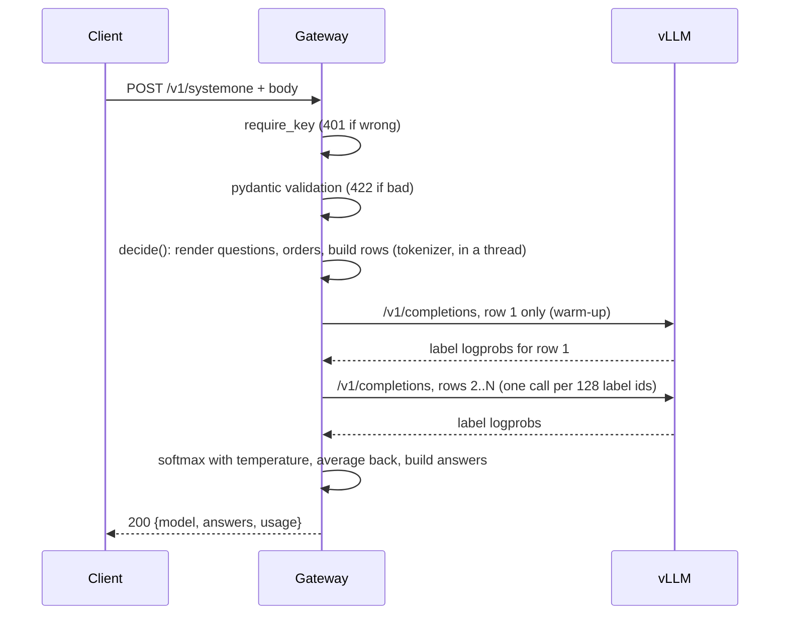
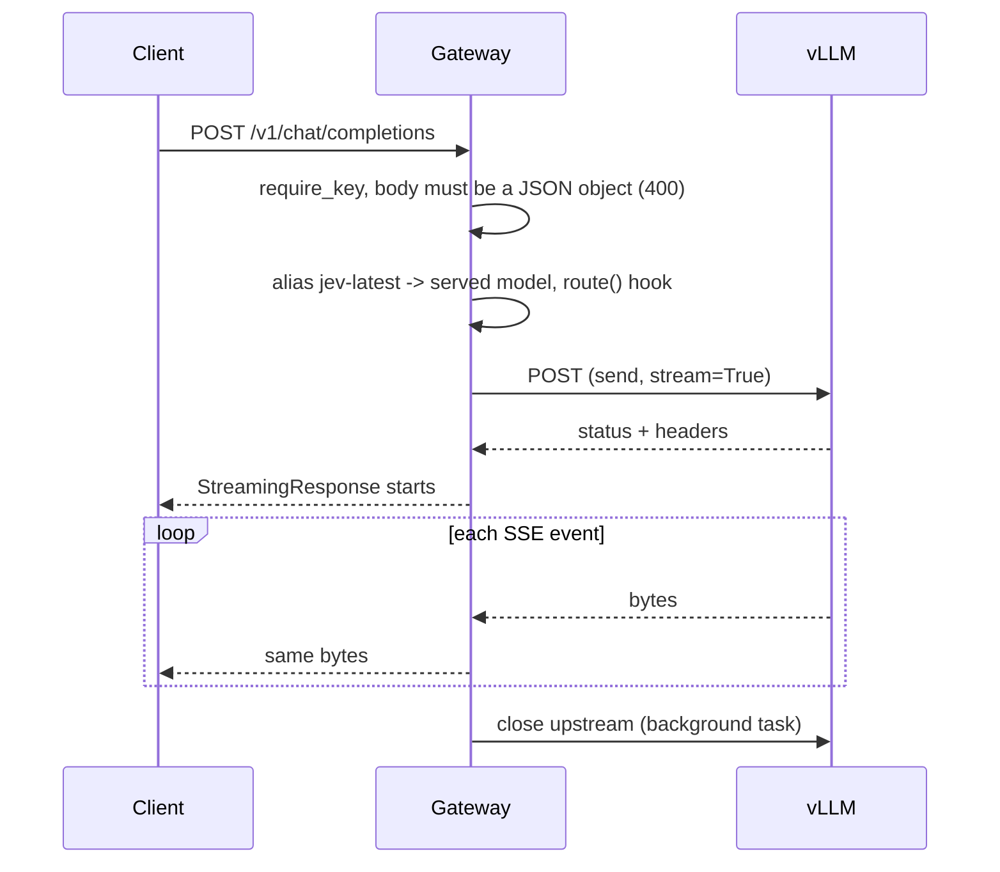
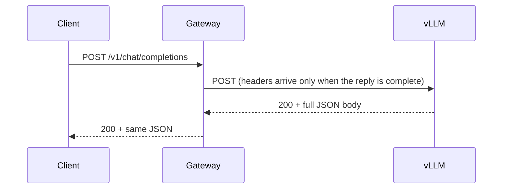
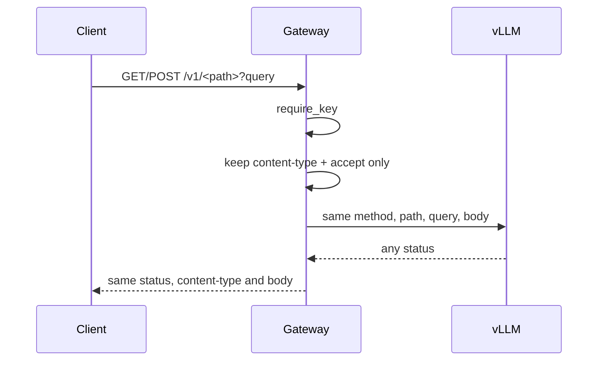
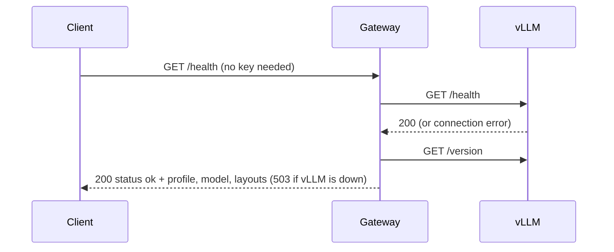

# The life of a request through the gateway

Based on the gateway code as of 2026-09-29 ([`app.py`](../../gateway/app.py),
[`chat.py`](../../gateway/chat.py), [`disconnect.py`](../../gateway/disconnect.py),
[`decide.py`](../../gateway/decide.py), [`readout.py`](../../gateway/readout.py)) and the
[compose file](../../compose.yaml). It is a reading of the code, backed by the unit and live tests.

## Short answer

- **Two processes, one model.** Clients talk to a small CPU **gateway** (port 9000). It
  talks to **vLLM** (port 8000), which owns the GPU and the model.
- **The gateway does three jobs:** it checks the key, turns `/v1/systemone` into vLLM
  `/v1/completions` calls, and forwards everything else to vLLM unchanged.
- **Every route is guarded the same way:** one key check, one error format
  (`{"error": {"message": ...}}`), and one disconnect watcher.
- **A client that leaves stops the GPU work.** The gateway cancels its own call to vLLM and
  vLLM aborts the request. A live test proves it.
- **Only the readout has a read timeout (600 s).** Proxied calls have none on purpose.

## 1. The stack

```
client --HTTP--> gateway :9000 --HTTP (httpx, one pool)--> vLLM :8000 --> GPU
                 CPU, FastAPI                              one process, one model
```

| | Gateway | vLLM |
|---|---|---|
| Runs | uvicorn + FastAPI on CPU ([Dockerfile](../../docker/gateway.Dockerfile)) | `vllm serve` on the GPU ([entrypoint](../../docker/vllm-entrypoint.sh)) |
| Port | 9000, bound to `127.0.0.1` | 8000, bound to `127.0.0.1` |
| Loads | tokenizer, prompt layouts, label tables, temperatures | model weights, KV cache |
| Mounts (read-only) | `~/.cache/huggingface`, `prompts/`, `data/` | `~/.cache/huggingface` |

- **Start order:** the gateway `depends_on` vLLM being healthy, so it starts second
  ([compose.yaml](../../compose.yaml)).
- **Offline:** both set `HF_HUB_OFFLINE=1`, so the shared, read-only HF cache is enough.
- **One connection pool:** `vllm_client` in `app.py` builds a single `httpx.AsyncClient`
  at startup, and every call goes through it.

## 2. Sequence diagrams

### 2.1 `POST /v1/systemone`



- **Auth and validation come first**, before any GPU work. `require_key` is a route
  dependency; a bad body becomes a 422.
- **Warm-up call:** with more than one row and a shared prefix of at least 512 tokens
  (`WARM_MIN_PREFIX_TOKENS`), row 1 goes alone so the others hit vLLM's prefix cache. See
  [prompt-sharing.md](prompt-sharing.md). Otherwise all rows go in one call.
- **Batch calls:** each vLLM call can score at most 128 label ids
  (`MAX_LABEL_IDS`, [readout.py](../../gateway/readout.py)). Options beyond that are split
  into more calls over the same prompts.
- **Steps 1-7 of the flow** (render, orders, rows, readout, softmax, average back,
  answers) are listed in the project's [CLAUDE.md](../../CLAUDE.md); answer meaning is in
  [../6-answer-compatibility.md](../6-answer-compatibility.md).

### 2.2 Streaming chat (`stream: true`)



### 2.3 Non-streaming chat

The same code path as 2.2. The gateway does not know or care whether the body is JSON
or SSE: `proxy()` streams whatever vLLM sends "byte for byte". For a non-streaming request
vLLM sends nothing until the whole answer is ready, so the client simply waits, and the
bytes then arrive at once.



### 2.4 `/v1/*` passthrough

`GET`/`POST` on any other `/v1/...` path (for example `/v1/completions`) is forwarded by `passthrough`.



- **vLLM's errors pass through as they are** (vLLM's format and status, not the
  gateway's `{"error": {"message": ...}}` shape).
- **`GET /v1/models` is not a plain passthrough:** `list_models` adds the Jev aliases
  (`jev-latest`, `jev-preview`) to vLLM's list. It has no disconnect watcher.

### 2.5 `GET /health`



`/health` has no `require_key`, so orchestrators can poll it. It reports the gateway's
profile, model and revision, and only asks vLLM for its version when vLLM is healthy.

## 3. Auth

Two separate keys guard two separate hops.

| Hop | Key | How |
|---|---|---|
| client → gateway | `GATEWAY_API_KEY` (optional) | `require_key` in [app.py](../../gateway/app.py) |
| gateway → vLLM | `VLLM_API_KEY` (optional) | `Authorization` set once on the httpx client in `vllm_client` |

- **Comparison:** `secrets.compare_digest` on the raw header bytes against
  `Bearer <key>`, so the check takes the same time however many characters match.
- **Failure:** 401 with `WWW-Authenticate: Bearer`. The HTTP exception handler keeps
  that header (and `Allow` for 405).
- **No key set means no check.** That is the default on a single workstation.
- **Forwarded client headers:** only `content-type` and `accept`
  (`FORWARDED_HEADERS` in [chat.py](../../gateway/chat.py)). **Never `Authorization`**:
  it holds the gateway key, and vLLM's own key comes from the client pool instead.
- **`/health` is open**; vLLM's port 8000 is unauthenticated for `/health`, `/metrics`,
  `/version`, `/tokenize` even with a key, so the loopback binding is the real protection
  ([README security section](../../README.md)).

## 4. Errors

Every gateway error body is `{"error": {"message": "..."}}`.

| Status | Cause | Raised in |
|---|---|---|
| 400 | Chat body is not a JSON object | `chat_completions` route (`json_object`) |
| 401 | Missing or wrong gateway key | `require_key` |
| 404 | Unknown path outside `/v1` (Starlette routing); on `/v1/*` vLLM answers 404 itself and it passes through | Starlette / vLLM |
| 405 | Wrong method on a known path | Starlette routing, through `http_error` |
| 422 | Body fails pydantic validation (`RequestValidationError`) | `invalid_body`, message is `<field>: <msg>` joined by `; ` |
| 422 | Request refused: empty questions, unknown layout, bad option-order setting, over a capacity limit, prompt too long | `RequestError` in [decide.py](../../gateway/decide.py), [questions.py](../../gateway/questions.py), [readout.py](../../gateway/readout.py); handler `refused` |
| 499 | Client left before the work finished (nobody sees it) | `client_left` |
| 500 | Any unexpected exception, with a `request_id` | handler `failed` |
| 503 | vLLM unreachable (`httpx.TransportError`) | `vllm_down` |
| 504 | vLLM call timed out (`httpx.TimeoutException`) | `vllm_slow` |

- **503 vs 504:** `TimeoutException` is a subclass of `TransportError` in httpx, and
  Starlette picks the handler for the most specific class, so timeouts give 504. A unit
  test pins it ([test_app.py](../../tests/unit/test_app.py)).
- **The Decision Index harness reads the 422 text.** `RequestError`'s docstring says
  capacity messages "keep the decision-index harness marker text". The three markers:
  - `at most 255 options per choice (got N)`
  - `a score takes 2 to 10 levels`
  - `prompt is longer than the maximum context length`

  Changing that wording could break the harness; tests pin it
  ([test_app.py](../../tests/unit/test_app.py), [test_edge_cases.py](../../tests/live/test_edge_cases.py)).
  Why the harness needs 422 and not 500: [../5-combined-server.md](../5-combined-server.md).
- **Prompt too long, two places:** `decide` checks the longest row against
  `max_model_len`; the readout also turns vLLM's 400 "maximum context length" into the same 422.
- **Other vLLM errors in the readout** (for example a 400 for another reason) go through
  `raise_for_status`, which raises `httpx.HTTPStatusError`. That is not a transport error,
  so it lands in the catch-all as a 500.
- **A real error body**, from a request without the key when `GATEWAY_API_KEY` is set:

  ```
  HTTP/1.1 401 Unauthorized
  www-authenticate: Bearer

  {"error":{"message":"invalid or missing API key"}}
  ```

## 5. Client disconnects

An abandoned request must not keep the GPU busy, and the SDK retries make that worse
(each retry would pile onto the last).

- **The race:** `unless_disconnected` ([disconnect.py](../../gateway/disconnect.py)) starts
  the work and a watcher that waits for Starlette's `http.disconnect` message. Whichever
  finishes first wins.
- **If the client leaves first:** the work task is cancelled. That cancels the pending
  httpx call, which closes its connection, and vLLM aborts the request when the socket closes.
  The route returns 499 (never read).
- **If the work finishes first:** its result is returned even if the client just left, so
  a half-open upstream response still gets closed.
- **Used by:** `/v1/systemone`, `/v1/chat/completions` and the `/v1/*` passthrough. It
  guards the time until the response *starts*.
- **Streaming after that:** once the `StreamingResponse` is running, Starlette stops
  iterating the body when the client disconnects, and the `BackgroundTask(upstream.aclose)`
  closes the upstream stream. This is Starlette's behaviour, not gateway code.

**Proof:** [test_abandoned_requests.py](../../tests/live/test_abandoned_requests.py) (needs an
idle stack). For systemone, chat and streaming chat it:
1. sends a big request and gives up (timeout or closing the stream);
2. watches vLLM's `/metrics` gauges `num_requests_running + num_requests_waiting`;
3. requires them to reach 0 within 5 s and stay 0 for 5 more (a decision still running
   would send its next call).

For chat it also checks `request_success_total` did not grow, meaning vLLM aborted rather
than finished. vLLM 0.30 does not count aborts in that counter, even as "abort", so
"not counted" is how an abort shows up there.

## 6. Timeouts

| Call | Timeout | Where |
|---|---|---|
| Readout (`/v1/completions` from `decide`) | 600 s for each of connect, write, pool and read (vLLM sends nothing until it is done, so the read timeout acts as a total) | client default in `vllm_client` |
| Proxied calls (chat, passthrough) | 600 s to connect/write, **no read timeout** | `PROXY_TIMEOUT` in [chat.py](../../gateway/chat.py) |

- **Why no read timeout on proxies:** a non-streaming reply sends nothing until finished,
  and long "thinking" can pass 600 s. A gateway timeout would kill legitimate replies.
  The safeguard is the disconnect watcher instead: a client that gives up cancels the call.
- **Client side:** the TypeSafe SDK defaults to a 10 s timeout and retries twice on
  timeouts and 5xx errors ([README](../../README.md)). Large decisions can exceed 10 s, so
  raise `timeout` (the README example uses 120). Section 5 keeps the retries from
  stacking on the GPU.

## 7. Logging

- **Logger:** `uvicorn.error`, the one uvicorn configures in the container, so INFO
  lines reach `docker compose logs`.
- **What is logged:** "cancelled: client disconnected" at INFO for 499s, and on a 500 the
  `request_id` and the exception *type* only.
- **What is never logged:** request content (state, questions, chat messages). Keys are
  also hidden: `Settings` marks them `repr=False`.
- **Finding a 500:** the client gets `{"error": {"message": "internal error", "request_id": "..."}}`;
  grep the gateway log for that id.

## Caveats

- **Control flow, not timing:** the diagrams show order, not how long each step takes.
- **Streaming disconnects** rely on Starlette's `StreamingResponse` (uvicorn advertises
  ASGI 2.3, so Starlette listens for `http.disconnect`); the live streaming test covers it.
- **vLLM version:** the abort-counting behaviour was checked in the vLLM 0.30 source when
  the live test was written; other versions may differ.
- **Phase 3:** `chat.route()` is still a pass-through; when systemone steers chat, the
  chat diagrams will gain a `decide` step.

## Sources

- Our code and tests: linked inline above.
- Project README (timeouts, error table, security): [../../README.md](../../README.md).
- Jev wire format and harness expectations: [../1-what-is-jev.md](../1-what-is-jev.md),
  [../5-combined-server.md](../5-combined-server.md).
- No external web sources were fetched for this document.
