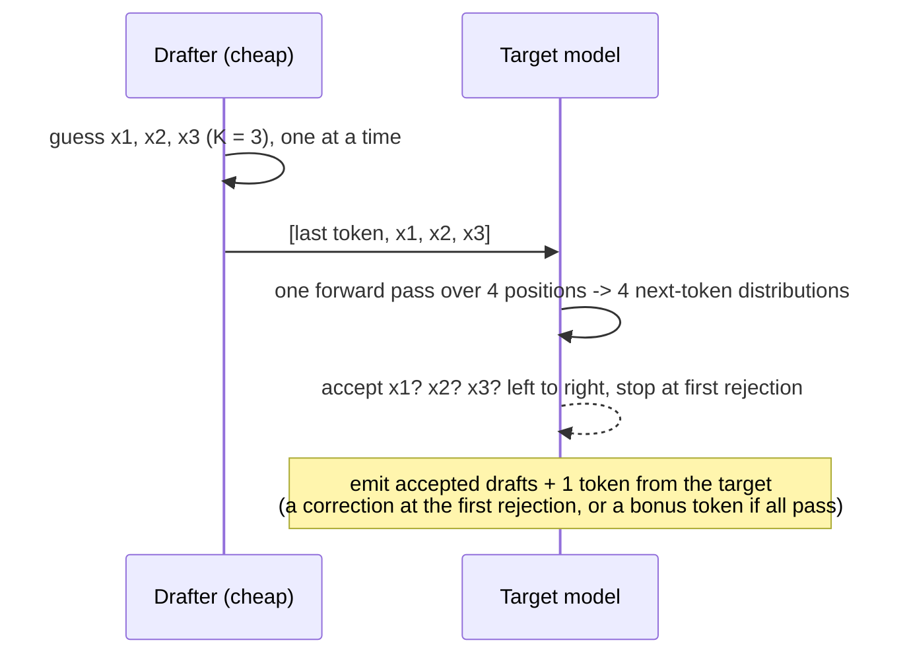

# Speculative decoding, recurrent layers, and MTP on hybrid Qwen

How speculative decoding works, how Mamba-style recurrent layers (Gated DeltaNet in our Qwen
models) keep their memory, and what happens in vLLM v0.30.0 when the two meet: Qwen's MTP
head drafting for chat while `/v1/systemone` reads label logprobs from the same model. The
DS-004 spike ([plan](../superpowers/plans/2026-10-06-ds-004-mtp-spike.md)) measured it on
Qwen3.6-27B. vLLM paths below are `vllm/...` at v0.30.0. KV cache mechanics are in
[kv-cache.md](kv-cache.md).

## Short answer

- **Speculative decoding** lets a cheap drafter guess K tokens; the big model checks all K in
  one forward pass and keeps the longest correct run, plus one token of its own. With the
  standard acceptance rule the output distribution is exactly the big model's; at
  temperature 0 the output is its greedy text, up to bf16 rounding.
- **It pays because decode is memory-bound:** checking 1 + K tokens costs about as much as
  generating 1. It costs 1 + K tokens of the step budget per drafting request.
- **Drafters:** a separate small model, EAGLE (a one-layer head on the big model's
  features), Medusa (parallel extra heads), or **MTP** (a next-next-token module trained with
  the model, as in DeepSeek-V3 and Qwen3.6).
- **Recurrent layers keep one fixed-size state** instead of a per-token KV history. That makes
  long prompts cheap, but a past state exists only if it was saved, and a state can't be
  "truncated" back to an earlier token.
- **So in vLLM,** prefix caching of state is checkpoint-based and block-aligned ("align"
  mode), and speculative decoding keeps one state slot per draft position.
- **MTP on Qwen3.6 (measured, DS-004):** chat under decision load went from 18.5 to
  **37.0 tokens/s** (50.2% of drafts accepted, 2.51 tokens per step).
- **But stock v0.30.0 breaks label scoring with MTP on:** any step with a drafting request
  goes through the rejection sampler, which drops `logprob_token_ids`. Under chat load all
  1,682 JevBench rows failed (HTTP 500). A ~15-line patch fixed it: 0 errors, max |Δp| 0.078
  vs MTP off, no flip with a top-two gap above 0.10.
- **MTP also moves hybrid Qwen's cache geometry:** blocks become 800 tokens, and the EAGLE
  "block drop" moves the saved state back one block. Our 784-token padding no longer lines up;
  multi-question prefix sharing under MTP is predicted (source read) to collapse and is
  untested.
- **Status:** MTP is not shipped. DS-004 continues (Qwen3.8 arms, latency, recommendation).

## 1. Speculative decoding in general

### 1a. Draft, then verify

A normal decode step produces one token per request and reads all the weights to do it
([prefill-and-decode.md §1](prefill-and-decode.md)). Speculative decoding spends that read on
more than one token:



- Every step emits between 1 and K + 1 tokens, never fewer than plain decoding.
- Leviathan et al. model the number of tokens per step as "a capped geometric variable": with
  acceptance rate α per draft, the expected count is (1 − α^(K+1)) ÷ (1 − α).

### 1b. The acceptance rule, and why it is lossless

Let p be the target's distribution and q the drafter's at a position, and x the drafted
token (Leviathan et al. §2.3; Chen et al. use the same rule with the letters swapped):

1. accept x with probability min(1, p(x) ÷ q(x));
2. if rejected, sample a replacement from norm(max(0, p − q));
3. the result is distributed exactly as p, "for any distributions p(x) and q(x)".

vLLM v0.30.0 implements this as "p(x) > u · q(x)" with a uniform u
(`vllm/v1/worker/gpu/spec_decode/rejection_sampler_utils.py:630-664`). **At temperature 0**
the rule degenerates: "Accept IFF draft matches target argmax", and on rejection the target's
argmax is emitted (`rejection_sampler_utils.py:571-594`). So greedy output equals the
target's greedy output.

### 1c. "Lossless" in practice: bf16

The proof is about exact arithmetic. In practice the verify pass runs the target over K + 1
positions per request, a different shape from a 1-token decode step, so kernels may sum in a
different order and produce slightly different logits
([determinism.md §1](determinism.md)). vLLM's docs say speculative sampling is "theoretically
lossless up to the precision limits of hardware numerics" and that batch size changes "may
cause variations in logprobs". A greedy chat can therefore diverge at a near-tie. We have not
measured greedy chat equality yet (DS-004 plans `scripts/chat_fidelity.py`).

### 1d. Kinds of drafter

| Drafter | What drafts | Trained how | Notes |
|---|---|---|---|
| **Draft model** (Leviathan; Chen) | A separate small LM with the same vocabulary | Independently | Its own weights and KV cache; Chen et al.: 2–2.5× on Chinchilla 70B |
| **Medusa** (Cai et al.) | Extra heads on the last hidden state, each predicting t+2, t+3, … in parallel | Heads only (Medusa-1) or jointly (Medusa-2) | Tree attention verifies several candidates at once |
| **EAGLE** (Li et al.) | One transformer layer fed the target's second-to-top features plus the token sequence "advanced by one time step" | Head only, target frozen | Drafts autoregressively at the feature level; reuses the target's embedding and LM head |
| **MTP** (DeepSeek-V3; Qwen3-Next/3.6) | A module trained with the model to predict one token further, keeping "the complete causal chain" | Jointly, as a training objective | Can be "discarded" at inference or "repurposed for speculative decoding"; DeepSeek-V3 reports 85–90% acceptance for the second token, 1.8× tokens/s |

vLLM treats MTP as an EAGLE-like method: same proposer machinery, same prefix-cache rules
(§3c).

### 1e. What it costs: the step budget

- **Each drafting request schedules 1 + K tokens per step** (the last accepted token plus K
  drafts). vLLM's scheduler gives each request `num_tokens_with_spec − num_computed_tokens`
  (`vllm/v1/core/sched/scheduler.py:560-571`, `656-665`).
- **The drafter's own passes** run after each target step: K small forward passes for MTP
  (one layer each, §3a).
- **vLLM warns below 8,192** scheduled tokens per step with speculative decoding
  (`vllm/config/vllm.py:2134-2141`). Our Qwen profiles use 2,352 with a 784-token
  per-request cap (DS-025); 4 chats × 4 tokens = 16 tokens a step, small next to that.
- **It helps when decode is memory-bound,** below the ~280-token-per-step crossover
  ([prefill-and-decode.md §1](prefill-and-decode.md)). In a step already full of prefill the
  extra K tokens are nearly free too, and each step now yields ~2.5 chat tokens instead of 1.

## 2. Recurrent layers: Mamba, Mamba-2 and Gated DeltaNet

### 2a. A state instead of a history

Attention keeps every earlier token's K and V and rereads them ([kv-cache.md §1](kv-cache.md)).
A recurrent layer folds each token into a fixed-size state and forgets the token:

```
attention:  output_t = f(Q_t, K_1..K_t, V_1..V_t)       memory grows with t
recurrent:  S_t = update(S_{t-1}, x_t);  output_t = g(S_t, x_t)    memory fixed
```

- **Mamba** (Gu & Dao, 2023) is a selective state-space model: the recurrence parameters
  depend on the input, letting the model "selectively propagate or forget information".
  Generating "requires only constant time per step since it does not require a cache of
  previous elements". Prefill uses a hardware-aware parallel scan instead of a token loop.
- **Mamba-2** (Dao & Gu, 2024) restates the layer as structured matrix multiplication
  ("state space duality") and computes it in chunks, 2–8× faster than Mamba's core.
- **A short causal convolution** sits before the recurrence in these blocks. Its state is the
  last kernel − 1 inputs (3 for Qwen's kernel of 4).

### 2b. Gated DeltaNet

Gated DeltaNet (Yang, Kautz & Hatamizadeh, ICLR 2025) keeps a d_v × d_k matrix S per head and
updates it with the gated delta rule:

S_t = S_{t−1} · (α_t (I − β_t k_t k_tᵀ)) + β_t v_t k_tᵀ

- **The gate α_t** fades the whole memory ("rapid memory erasure"; α → 0 clears it).
- **The delta rule** (β_t, k_t) first removes what the memory currently stores under key k_t,
  then writes v_t there ("targeted updates").
- **Training** uses a chunkwise-parallel form, so prefill is not a token-by-token loop.
- **Qwen3.6/3.8 layout:** 16 × (3 Gated DeltaNet + 1 gated attention), 16 QK heads and 48 V
  heads of dim 128; state 3.06 MiB per layer in fp32
  ([model-architectures.md §2](model-architectures.md), [kv-cache.md §2](kv-cache.md)).

### 2c. What a recurrent state means for serving

| Need | Attention (KV cache) | Recurrent state |
|---|---|---|
| Memory per request | grows with length | fixed (~147 MiB on Qwen) |
| Resume from token *t* | any *t*: keep the first *t* rows | only where a state was **saved** at *t* |
| Prefix caching | hash blocks of K/V, hit on any block boundary | save state copies at chosen points; hit only there |
| Undo the last *j* tokens (rejected drafts) | drop *j* rows | impossible: the state already absorbed them; keep a copy per position instead |

- **Prefix caching is checkpoint-based.** vLLM's align mode saves the state only at block
  boundaries and, by default, keeps only the last one before the prompt ends. Hits therefore
  land on multiples of the block size (784 tokens on Qwen)
  ([kv-cache.md §6](kv-cache.md), [prompt-sharing.md §2](prompt-sharing.md)).
- **Speculative decoding needs a state per draft position,** because a rejected draft can't
  be subtracted out (§3b).

## 3. How they interact in vLLM v0.30.0

### 3a. MTP on hybrid Qwen

- **One module.** Both Qwen checkpoints set `mtp_num_hidden_layers: 1` and carry 15 `mtp.*`
  tensors. vLLM maps the config to `Qwen3_5MTP` (`vllm/config/speculative.py:904-923`).
- **What it is:** an `fc` layer that joins the next token's embedding with the target's last
  hidden state, then one **full-attention** decoder layer, then the shared LM head
  (`vllm/model_executor/models/qwen3_5_mtp.py:119-125`, `160-172`).
- **Drafting recursively:** with `num_speculative_tokens` 3, the same layer runs three times,
  each on its own previous output (`spec_step_idx % num_mtp_layers`, line 171). vLLM does not
  count it as multi-module MTP (`speculative.py:1944-1950`), so the drafter reads one token
  past a prefill chunk, not three (`scheduler.py:280-286`).
- **Config used in DS-004:** `--speculative-config {"method":"mtp","num_speculative_tokens":3}`.

### 3b. Recurrent state under speculative decoding

- **One state slot per position.** A verify step for a drafting request reads and writes
  K + 1 state slots, one after each candidate token, and the next step continues from the slot
  of the last accepted token (`vllm/v1/attention/backends/gdn_attn.py:306-308`, `num_accepted_tokens`).
- **More state pages per request.** In align mode a running request holds 2 + K state pages per
  group (`vllm/v1/kv_cache_interface.py:1035-1045`): 3 groups × 5 = 15 pages with K = 3, vs 6.
- **A bigger state page.** The convolution state keeps `kernel − 1 + K` inputs
  (`vllm/model_executor/layers/mamba/mamba_utils.py:284-288`): 3,268,608 B instead of
  3,207,168, which pushes the block from 784 to **800 tokens** (logged: 571 blocks × 800, vs
  650 × 784 with MTP off on the same day; [kv-cache.md §6](kv-cache.md)).

### 3c. The EAGLE block drop, and what it does to Mamba checkpoints

**Why vLLM drops a block.** An EAGLE-like drafter needs the target's hidden states for the
tokens right before the generation point, and those are not cached (only K/V is). Also, after a
prefill chunk the drafter writes K/V one token past the chunk boundary, which may not match a
later request's next token (`vllm/v1/core/kv_cache_coordinator.py:114-124`). So:

- **attention hits drop their last matched block** to force recomputing it
  (`vllm/v1/core/single_type_kv_cache_manager.py:824-828`);
- **Mamba checkpoints follow** "Eagle's attention replay boundary"
  (`kv_cache_coordinator.py:154-158`): the kept state is ⌊(n − 1) ÷ B⌋ × B − B, one block
  lower than without MTP (`kv_cache_interface.py:1073-1082`, `scheduler.py:438-446`).

`"disable_eagle_block_drop": true` in the speculative config turns both off. vLLM calls it
"experimental ... for measuring the acceptance-rate impact of reusing that block"
(`vllm/config/speculative.py:440-444`) and logs a warning that acceptance may change.

**What it means for prompt lengths** (B = 800 with MTP):

| Prompt n | Kept state, MTP off (B = 784) | MTP, drop on | MTP, drop off |
|---|---|---|---|
| ≤ 800 | none (n ≤ 784) or 784 | none | none |
| 801–1,600 | 784 (1,568 from n = 1,569) | **none** | 800 |
| 2,832 (row 1: 2,352 padded + 480) | **2,352** = end of the shared part | 1,600 | 2,400 (inside row 1's own question) |

**Multi-question systemone under MTP (predicted from the source, not measured).** Today front
padding puts row 1's checkpoint exactly at the end of the shared part
([prompt-sharing.md §7](prompt-sharing.md)). With MTP on and the gateway still padding to 784:

- **drop on:** a sibling row's attention hit is 1,600 (its third block differs), the drop
  makes it 800, and no state is kept at 800, so the hit falls to **0**;
- **drop off:** the only kept state (2,400) contains row 1's own question tokens, so siblings
  again hit **0**;
- either way every sibling would recompute its whole shared part: computed ÷ usage would go
  from today's 1.05 toward the 6.7× of no sharing at all
  ([prompt-sharing.md §2](prompt-sharing.md));
- **padding to 800 instead** should give siblings 2,400 tokens with the drop off, or 1,600 with
  it on (one block lost).

DS-004 could not see this: JevBench rows have one question, so every arm, MTP or not, shows
0% cached tokens. A multi-question bench under MTP is the test. v0.30.0 also has an untested
`--enable-mamba-fine-grained-prefix-cache`, which saves a checkpoint where an EAGLE/MTP sibling
resumed; it needs align mode and a `--prefix-match-unit` below the block size
(`vllm/config/cache.py:187-192`).

### 3d. The `logprob_token_ids` gap in the rejection sampler

`/v1/systemone` reads answer letters with `logprob_token_ids` and `max_tokens: 1`
([decision-readout.md §5](decision-readout.md)). Decision rows never draft. But:

1. **If any request in a step has draft tokens, the whole batch goes through the rejection
   sampler** (`vllm/v1/worker/gpu/model_runner.py:1552-1564`).
2. **The rejection sampler sizes logprobs from top-k only** (`rejection_sampler.py:300-302`)
   and calls `compute_topk_scores` without the label-id state
   (`vllm/v1/worker/gpu/spec_decode/rejection_sampler.py:142-148`). The normal sampler passes it
   (`vllm/v1/worker/gpu/sample/sampler.py:157-171`).
3. **Result for a co-batched decision row:** an empty logprobs list and an `IndexError` in
   `vllm/entrypoints/openai/completion/serving.py:673` (HTTP 500), or, if a chat in the batch
   asked for top-k, that top-k instead of the labels. There is no per-request switch.

This is why CLAUDE.md lists "no speculative decoding/MTP with label scoring (#42592)": #42592
is the V1 runner's version; the V2 runner gap is still in v0.31.0.

**The patch** gives the rejection sampler the normal sampler's label-id path:
`get_logprobs_dims` for sizing and `logprob_token_ids_state` plus the chunk's
`expanded_idx_mapping` for `compute_topk_scores`. No new kernels. It was bind-mounted over the
v0.30.0 image ([runbook](../results/ds-004/runbook.md)); an
[upstream PR](../results/ds-004/upstream-pr.md) is drafted and not posted.

**The fallback considered first:** reading top-K (`logprobs=K`) instead of label ids. A CPU
simulation on 2,827 collected questions ([step 0](../results/ds-004/topk-sim.md)) found
0 answer flips but probability moves up to 0.12 on Qwen3.6 at K = 64 (θ = −12), all on choice
questions with more than 20 labels, and up to 0.6–0.8 on Gemma (dropped from DS-004). The patch
made this fallback unnecessary for Qwen.

### 3e. What DS-004 measured on Qwen3.6-27B

JevBench through the gateway, 1,682 rows per arm; "load" is 4 streaming chats
([Qwen3.6 results §1](../results/ds-004/qwen3.6-27b/results.md)).

| Arm | vLLM | MTP | Load | Errors | p50 / p95 ms |
|---|---|---|---|---|---|
| A | stock | off | idle | 0 | 115 / 286 |
| A′ | stock | off | chat | 0 | 327 / 631 |
| E | stock | on | chat | **1,682** | — |
| P | patched | on | idle | 0 | 137 / 479 |
| P′ | patched | on | chat | 0 | 387 / 1,067 |

| Comparison | max \|Δp\| | Flips (largest baseline gap) |
|---|---|---|
| A′ vs A (bf16 noise under load) | 0.027 | 2 (0.025) |
| P vs A (MTP on, idle) | 0.077 | 3 (0.025) |
| P′ vs A′ (candidate vs stock, both loaded) | 0.078 | 4 (0.063) |
| Pnd vs A (drop off, idle) | 0.054 | — |
| Pnd′ vs A′ (drop off, loaded) | 0.044 | — |

- **Accuracy** 89.1–89.2% in every arm; no flip had a top-two gap above 0.10.
- **The patched path really ran:** its counter logged 2,200 rejection-sampler steps with
  label-id rows in P′ and none in P (idle decisions never share a step with drafts).
- **Drop off, idle, prompts under 784 tokens: bit-identical to MTP off** (max |Δp| 0.000). The
  784–1,568-token band still drifts (0.054) with the drop off.
- **Chat:** p50 18.5 → **37.0 tokens/s** (A′ → P′), TTFT 269 → 340 ms, 50.2% of drafts
  accepted, mean accepted length 2.51 (= 1 + 3 × 0.502). With the drop off: 35.1 tokens/s,
  50.0%. Stock MTP (arm E) gave 36.1.

**The drift is restart noise, not MTP.** Restarting the stock MTP-off server gives max
|Δp| 0.079 against the first run (3 flips, all in close banking77 rows), as much as any MTP
arm. Within one running instance results repeat bit for bit, so A′ vs A (0.027, same
instance) understates the noise between restarts. Pnd matching A exactly under 784 tokens
was luck between two instances ([Qwen3.6 results §2](../results/ds-004/qwen3.6-27b/results.md)).

## 4. Latency for prompts ≥ 784 tokens with MTP on (DS-004)

With MTP on, decisions of 784–1,568 tokens got ~60% slower even idle (p50 274 → 445 ms),
while shorter ones rose ~20 ms. The cause is the chunk cap meeting the new block size
([Qwen3.6 results §2](../results/ds-004/qwen3.6-27b/results.md)):

- MTP grows the conv state to `kernel − 1 + num_spec` positions, so the block becomes 800
  tokens (`mamba_utils.py:274-295`, `platforms/interface.py:922-932`; [kv-cache.md §6](kv-cache.md)).
- In align mode the scheduler cuts prefill at block boundaries
  (`_mamba_block_aligned_split`, `scheduler.py:471-512`). With
  `--long-prefill-token-threshold 784` below the 800-token block, every block costs two
  steps, 784 + 16. A 1,000-token prompt takes 3 engine steps instead of 2.
- At these sizes a step costs about the same whatever its size (16 tokens ≈ 123 ms, 784 ≈
  131 ms), so the extra step adds ~100 ms. A step log from a patched scheduler matched the
  predicted chunks for every probed length.
- `disable_eagle_block_drop` does not change the chunking, which is why P ≈ Pnd.

| Run (784–1,049-token rows, idle) | Steps per row | p50 / p95 ms |
|---|---|---|
| stock, MTP off (rerun) | 2 | 259 / 311 |
| MTP, cap 784 / budget 2352 (shipped) | 3 | 373 / 470 (first run 445 / 611) |
| MTP, cap 800 / budget 2400, drop off | 2 | 291 / 370 |

Realigning the cap and budget to the 800-token block restores the step count, leaving the
same +20–30 ms MTP cost seen on short prompts. Not yet measured with that setting: chat load
and chat tokens/s. The same rule applies to chat prefills: any cap below the block size
doubles their steps (from the code).

## 5. What it means for us

- **MTP doubles chat speed under decision load on Qwen3.6,** at a probability cost (max |Δp|
  0.078) within restart-to-restart noise (0.079), but only with the patched rejection sampler. Stock
  v0.30.0 cannot serve systemone with MTP on.
- **Shipping MTP would also need:** the gateway's prefix padding moved from 784 to the MTP
  block size (800), a decision on the block drop, a multi-question bench to confirm prefix
  sharing (§3c), the chunk cap and budget realigned to 800 / 2400 (§4), and refitted calibration if probabilities move
  ([calibration.md](calibration.md)).
- **Keep the KV cache bf16 with MTP** (#49010, [kv-cache.md §7](kv-cache.md)).
- **Gemma stays without MTP** in DS-004; Qwen3.8 arms are still to run.

## Caveats

- **One model, one day.** All MTP measurements are Qwen3.6-27B on 2026-10-06, one run per arm.
- **Chat speed** comes from `stream_options.include_usage`, since one streamed chunk can carry
  several tokens under MTP.
- **Source reads, not measurements:** §3c's multi-question prediction, the chunk traces and
  the drift explanation. They are v0.30.0-specific.
- **Unexplained:** with the drop on, prompts under 784 tokens drift up to 0.047 even idle,
  while the drop off gives 0.000. The chunking traced in kv-cache.md §9 is the same in both.
- **Patched build:** the e2e numbers are from the v0.30.0 patch, not an upstream release.

## Sources

Ours: [DS-004 plan](../superpowers/plans/2026-10-06-ds-004-mtp-spike.md),
[step 0](../results/ds-004/topk-sim.md),
[Qwen3.6 results](../results/ds-004/qwen3.6-27b/results.md),
[runbook](../results/ds-004/runbook.md), [upstream PR draft](../results/ds-004/upstream-pr.md),
arm summaries in `docs/results/ds-004/qwen3.6-27b/*/summary.md` and `chat-load/*.txt`;
[kv-cache.md](kv-cache.md), [model-architectures.md](model-architectures.md),
[prompt-sharing.md](prompt-sharing.md), [determinism.md](determinism.md),
[5-combined-server.md](../5-combined-server.md).

vLLM v0.30.0 source, https://github.com/vllm-project/vllm/tree/v0.30.0 (lines as cited):
`vllm/v1/worker/gpu/spec_decode/rejection_sampler.py`, `rejection_sampler_utils.py`,
`vllm/v1/worker/gpu/model_runner.py`, `vllm/v1/worker/gpu/sample/sampler.py`,
`vllm/entrypoints/openai/completion/serving.py`, `vllm/config/speculative.py`,
`vllm/config/vllm.py`, `vllm/config/cache.py`, `vllm/model_executor/models/qwen3_5_mtp.py`,
`vllm/model_executor/layers/mamba/mamba_utils.py`, `vllm/v1/attention/backends/gdn_attn.py`,
`vllm/v1/core/kv_cache_coordinator.py`, `vllm/v1/core/single_type_kv_cache_manager.py`,
`vllm/v1/core/sched/scheduler.py`, `vllm/v1/kv_cache_interface.py`.

Papers and docs (raw copies in `.firecrawl/background/kv-spec/`):
- Leviathan, Kalman & Matias, "Fast Inference from Transformers via Speculative Decoding",
  ICML 2023: acceptance rule and proof (§2.3), expected tokens per step (§3.1), 2–3× on
  T5-XXL. https://arxiv.org/abs/2211.17192
- Chen et al., "Accelerating Large Language Model Decoding with Speculative Sampling", 2023:
  modified rejection sampling, 2–2.5× on Chinchilla 70B. https://arxiv.org/abs/2302.01318
- Li et al., "EAGLE: Speculative Sampling Requires Rethinking Feature Uncertainty", ICML 2024.
  https://arxiv.org/abs/2401.15077 (EAGLE-2: https://arxiv.org/abs/2406.16858; EAGLE-3:
  https://arxiv.org/abs/2503.01840)
- Cai et al., "Medusa: Simple LLM Inference Acceleration Framework with Multiple Decoding
  Heads", 2024. https://arxiv.org/abs/2401.10774
- DeepSeek-AI, "DeepSeek-V3 Technical Report": MTP modules, inference use, 85–90% second-token
  acceptance, 1.8× tokens/s. https://arxiv.org/abs/2412.19437
- Gu & Dao, "Mamba: Linear-Time Sequence Modeling with Selective State Spaces", 2023.
  https://arxiv.org/abs/2312.00752
- Dao & Gu, "Transformers are SSMs" (Mamba-2, SSD), 2024. https://arxiv.org/abs/2405.21060
- Yang, Kautz & Hatamizadeh, "Gated Delta Networks: Improving Mamba2 with Delta Rule", ICLR
  2025: update rule (Table 1), gating vs delta rule. https://arxiv.org/abs/2412.06464
- Qwen3.6-27B model card (layout, MTP "trained with multi-steps"):
  https://huggingface.co/Qwen/Qwen3.6-27B; Qwen3-Next blog (3:1 hybrid, native MTP).
- vLLM docs, Speculative Decoding (lossless guarantees and their limits):
  https://docs.vllm.ai/en/latest/features/spec_decode.html
- vLLM issues: #42592 (spec decode + label scoring, V1 runner), #49010 (fp8/nvfp4 KV + MTP on
  sm_120), as recorded in the DS-004 plan and [sources.md](../sources.md).
