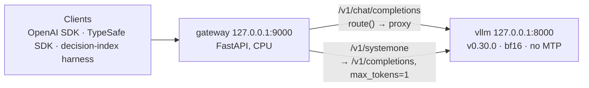

# Phase 1 design: shared vLLM server with chat + `/v1/systemone`

Date: 2026-09-28. Status: approved in brainstorming, pending spec review.
Background research: `docs/README.md` (especially docs 1, 5 and 6).

## Goal

Run one model on one GPU (RTX PRO 6000, 96 GB) and serve from it:

- normal OpenAI chat, with thinking on by default;
- a Jev-compatible `/v1/systemone` decision endpoint.

Phase 1 is done when the stack runs on all three model profiles, passes its tests, works
with the official TypeSafe SDK, and has a committed latency report per profile.

## Decisions

| Topic | Decision | Why |
|---|---|---|
| Architecture | vLLM owns the model; our own thin FastAPI gateway serves `/v1/systemone` and proxies **all** chat | Keeps vLLM untouched; lets systemone answers steer chat later (phase 3) |
| Runtime | Docker Compose for `vllm` + `gateway`; uv venv on the host for scripts and tests | Matches the owner's other projects |
| vLLM | `vllm/vllm-openai:v0.30.0` | Current release; supports `logprob_token_ids` |
| Models | `Qwen/Qwen3.8-27B`, `Qwen/Qwen3.6-27B`, `google/gemma-4-31B-it`, bf16, one loaded at a time | bf16 is the reference for calibration and index comparison |
| Thinking | On for chat by default, switchable per request; always off in systemone prompts | Supported per request by both model families |
| MTP | **Off in phase 1**; investigated in a spike | vLLM cannot disable MTP per request. With MTP on, `logprob_token_ids` requests go through the rejection sampler, which drops them (v0.30.0 `model_runner.py:1552-1583`) |
| Prompt layout | Editable prompt files (`prompts/<layout>.toml`), selected per profile, with an optional per-request override. Three ship: `decider_chat` (default, state first), plus experimental `header` and `question_first` | Wording can change without touching code. The default lets us reuse decider's published temperature (Qwen3.6-27B: 1.943) and compare with its index scores. Question placement matters on long documents (snapjudge invoices: state-first 41/75, header 45/75, question-first 50/75) |
| Option order | The renderer can permute options and map probabilities back; averaging over orders is supported but off by default | LLMs show strong option-order and label-token bias (Pezeshkpour & Hruschka 2023; Zheng et al. 2023; Jev itself: 88% vs ~60%), but averaging helped in one reproduction and not in another. Phase 2 measures it before any default changes |
| Label vocabulary | Built ahead of time from each tokenizer and stored with the tokenizer hash | Guarantees every option label is exactly one token |
| HF weights | Host `~/.cache/huggingface` mounted into the containers | No re-downloads |

## Architecture



### Repository layout

```
compose.yaml        vllm + gateway services
profiles/           one env file per model profile
gateway/            the FastAPI app (Python package)
  app.py            routes: /v1/systemone, /v1/chat/completions, /v1/models, /health, other /v1/* passthrough
  schema.py         Jev request/response models (pydantic v2)
  labels.py         load + verify the label vocabulary
  prompts.py        fills a prompt layout for one question (no prompt text lives here)
  readout.py        prompts → vLLM → per-question letter logprobs
  answers.py        probabilities → Jev answers + TypeSafe confidence
  calibration.py    temperatures per profile, layout and question type
  chat.py           chat proxy + route() hook
prompts/            prompt layouts as editable text, one TOML file each
  decider_chat.toml   default, state first; matches decider token for token
  header.toml         experimental: all questions, then state, then each question
  question_first.toml experimental: question and options, then state
scripts/            build_labels.py, bench.py, bench_data.py (phase 2 adds calibrate.py, evaluate.py)
tests/unit/         CPU-only, fast
tests/parity/       decider_chat prompts vs decider's, token for token
tests/live/         need the running stack (pytest -m live)
data/<profile>/<layout>/  labels.json, calibration.json
data/bench/         bundled public-domain text for synthetic states
docs/results/       benchmark reports
```

Stack: Python 3.12, uv, FastAPI, httpx, pydantic v2, transformers (tokenizers and chat
templates only, CPU), pytest, ruff.

## Model profiles

One env file per profile. You switch by restarting with a different file:
`docker compose --env-file profiles/<profile>.env up -d`.

| Profile | HF repo | bf16 weights | Reasoning / tool parser | Extra vLLM flags |
|---|---|---|---|---|
| `qwen3.8-27b` | `Qwen/Qwen3.8-27B` | ~55 GB | `qwen3` / `qwen3_xml` | `--language-model-only` |
| `qwen3.6-27b` | `Qwen/Qwen3.6-27B` | ~56 GB | `qwen3` / `qwen3_coder` | `--language-model-only` |
| `gemma-4-31b` | `google/gemma-4-31B-it` | ~62–65 GB | `gemma4` / `gemma4` | `--chat-template` (Gemma 4 tool template), `--default-chat-template-kwargs '{"enable_thinking": true}'` |

- **Shared vLLM flags:**
  - `--enable-prefix-caching --gpu-memory-utilization 0.90 --max-model-len 32768`
  - `--max-num-seqs 256`
    - vLLM's default 1024 exceeds the Mamba cache blocks of the hybrid Qwen models
  - `--enable-auto-tool-choice`
  - KV cache in bf16
  - no `--speculative-config`
- **Pinning:** each profile sets `HF_REVISION` to the model revision current at bring-up,
  and `PROMPT_LAYOUT` (default `decider_chat`). The label vocabulary and the temperatures
  are only valid for that revision + layout pair.
- **HF token:** none of the three models is gated (checked 2026-09-28). `HF_TOKEN` is
  passed through from the shell only if set.
- **Mounts:**
  - `vllm` mounts `~/.cache/huggingface` read-write.
  - `gateway` mounts it read-only, because it only needs the tokenizer.
  - Both services publish their ports on `127.0.0.1` only.
- **Gateway env:** `VLLM_URL`, `SERVED_MODEL`, `PROFILE`, `HF_REVISION`, `PROMPT_LAYOUT`,
  and an optional `GATEWAY_API_KEY`.

## Label vocabulary (`scripts/build_labels.py`, `gateway/labels.py`)

`build_labels.py --profile X` loads the pinned tokenizer and, for every layout in
`prompts/`, writes `data/X/<layout>/labels.json`:

- `labels`: A–Z, then two-letter uppercase codes, the first 255 that encode to exactly one
  token on their own (decider's rule). A–J, the labels of choices with 10 or fewer
  options, are also checked in context: `encode(answer + code) == encode(answer) + [id]`.
  Wider option lists are built from label token ids directly, so the model sees exactly
  the token we read.
- The order matches decider's label order.
- The file also stores the token ids, a hash of the tokenizer files, and a hash of the
  layout file.

At startup the gateway loads this file and recomputes both hashes. It refuses to start
on a mismatch, so an edited layout forces a label rebuild.

## `/v1/systemone` request flow

1. **Validate** (`schema.py`) against Jev's contract.
   - `questions` must be a non-empty map.
   - `choice`: 2–255 options; `null` descriptions are allowed.
   - `score`: 2–10 levels.
   - `noul`: criteria `{true, false}` are optional. Instructions may be omitted if the
     criteria describe true or false.
   - Model aliases `jev-latest` and `jev-preview`, plus the served name, map to the
     loaded model.
   - Every rejection is a **422** whose message contains the decision-index harness
     marker text, so the harness scores it as *unsupported*:
     - `options per choice`
     - `a choice needs at least two options`
     - `a score takes 2 to 10 levels`
     - `maximum context length`
2. **Render** (`prompts.py`): one prompt per question, built by filling the active
   layout file. `prompts.py` only fills placeholders and applies the model's chat
   template with thinking off. All wording lives in `prompts/<layout>.toml`, for example:

   ```toml
   # prompts/decider_chat.toml (exact whitespace pinned by the parity test)
   user = "Context:\n{state}\n\nQuestion: {question}\nOptions:{options}"
   option = "\n({label}) {text}"
   answer_prefix = "Answer: ("
   noul_no = "no"
   noul_yes = "yes"
   noul_question = "Which answer fits the context?"
   ```

   The default `decider_chat` layout reproduces
   `decider.serve.prepare(..., independent=True, isolated=False, chat=<model template>)`:
   - a single user turn: `Context:` + state, `Question:` + instructions, then the
     lettered options; the assistant turn ends at `Answer: (`;
   - objects and arrays in `state` rendered as JSON;
   - `noul` as options `(A) no[: <false description>]` and
     `(B) yes[: <true description>]`, and a `noul` without instructions uses
     `noul_question`;
   - `score` as lettered levels, level 0 first;
   - choices with 10 or fewer options in the A–J text rendering, and wider choices with
     one label token per option.

   Placeholders available to every layout: `{state}`, `{question}`, `{options}`, and
   `{questions}` (all of the request's questions, for the `header` layout). A new layout
   means a new TOML file, rebuilt labels, and a refitted temperature. No code changes.

   Layouts differ in whether the questions of one request can share a KV-cache prefix,
   which decides speed:

   | Layout | Prompt order | Shared prefix across a request's questions | Intended use |
   |---|---|---|---|
   | `decider_chat` | state → question → options | Yes (the state) | Default |
   | `header` | all questions → state → question → options | Yes (the question list + state) | Long documents with many questions ("query before and after the document", Liu et al. 2023) |
   | `question_first` | question → options → state | No; the state is prefilled once per question | Single-question requests, and fixed questions repeated across requests (phase-3 router) |

   **Option order.** The renderer takes an option permutation per question (identity by
   default) and maps the resulting probabilities back to the caller's option names. The
   setting `OPTION_ORDERS` (`identity` | `identity+reversed` | `cyclic:<k>`) renders each
   question once per order and averages the mapped probabilities. The extra rows share
   the state prefix, so the cost is mostly the question suffixes. Default: `identity`.

   **Per-request override (experiments only).** Optional non-Jev request fields `layout`
   and `option_orders` override the profile settings. Jev clients never send them.
   The gateway loads every layout in `prompts/` at startup, together with its labels.
3. **Read out** (`readout.py`).
   - Public interface: `letter_logprobs(prompts, label_ids) -> list[list[float]]`.
   - The gateway tokenizes the prompts itself and sends **one** batched
     `POST /v1/completions` with:
     - `prompt`: the list of token-id lists;
     - `max_tokens: 1`, `temperature: 0`, `logprobs: 0`;
     - `logprob_token_ids`: the union of the questions' label ids;
     - `return_tokens_as_token_ids: true`, `add_special_tokens: false`.
   - Values are read from `choices[i].logprobs.top_logprobs[0]["token_id:<id>"]`.
   - If the shared prefix covers at least one KV-cache block, the first question is sent
     alone to warm the cache, then the rest follow.
   - More than 128 label ids (vLLM's cap) are split across calls and the results merged.
4. **Calibrate** (`calibration.py`): each question's probabilities are
   `softmax(logprob / T)` over its own labels.
   - `T` comes from `data/<profile>/<layout>/calibration.json`, keyed by question type.
   - If the file is missing, `T = 1.0` and the gateway logs a warning at startup.
5. **Answer** (`answers.py`) in the exact Jev shapes.
   - `choice` returns `choice`, `probabilities` keyed by option names, and `confidence`.
   - `score` returns `score` (the probability-weighted level), `legend`,
     `probabilities` keyed `"0".."n-1"`, and `confidence`.
   - `noul` returns only `noul` = P(yes).
   - `confidence` uses TypeSafe's adapter formulas (`confidence_metrics.py`):
     - choice: `(p_max − 1/K)/(1 − 1/K)`;
     - score: `max(0, 1 − E|level − mode| / MAD_uniform)`.
   - Probabilities are rounded to 4 decimals.
   - `usage.input_tokens` is the state tokens once plus each question's own tokens.
     `usage.output_tokens` is 0.
6. **Errors.**
   - vLLM unreachable → 503.
   - Prompt longer than `max_model_len` → 422 with the marker text.
   - Anything else → 500, logged with the request id only, not the content.

## Chat flow (`chat.py`)

- `/v1/chat/completions` → `route(request)` → proxy to vLLM. Streaming (SSE) and
  non-streaming responses pass through byte-for-byte, tool calls included.
- `route()` is the identity function in phase 1. Phase 3 fills it in with systemone-driven
  choices of thinking and `reasoning_effort`. It will call the systemone logic in-process,
  not over HTTP.
- Other `/v1/*` paths pass through unchanged. `/v1/models` also lists the Jev aliases.
- Known limitation: a chat client that asks for top-k logprobs can get `-inf` values if
  its request shares a batch with a systemone request (vLLM PR #51789, open). The
  generated text is unaffected.
- Known limitation: decision prefill starves chat decode on the shared GPU — measured on
  qwen3.6-27b with 4 concurrent systemone clients: chat 26.6 → 1.2 chunks/s, long-prompt
  TTFT 144 → 3287 ms; tracked in ticket DS-007 (priority scheduling + smaller step budget
  + prefix alignment DS-008; see `docs/appendix/ds007-scheduling.md`).

## Testing

- **Unit** (`tests/unit`, CPU, no server):
  - schema validation and the 422 marker texts;
  - golden prompt strings for each layout × model template;
  - every file in `prompts/` loads and has all required keys and placeholders;
  - option permutations map probabilities back to the right option names, and averaging
    over orders matches a hand-computed example;
  - the label builder, using the real tokenizers from the HF cache;
  - readout maths: softmax with `T`, and merging the >128-label chunks;
  - confidence formulas: TypeSafe's examples give 0.82 and 0.775 for choice, and
    {0.65, 0.30, 0.05} gives 0.40 for score;
  - answer shapes;
  - the chat proxy against a fake vLLM (`httpx.MockTransport`), streaming included.
- **Parity** (`tests/parity`): with the `decider_chat` layout, our rendered token ids equal
  decider's `prepare()` output for a fixed set of requests. decider runs in an isolated uv
  tool environment because of its `numpy<2` pin. Other layouts are deliberately free to
  differ.
- **Live** (`tests/live`, `pytest -m live`, needs the stack up):
  - the official `typesafe-sdk` quickstart with `TYPESAFE_BASE_URL` pointed at the gateway;
  - edge cases: `null` option descriptions, `noul` without criteria, 255 options,
    more than 128 options, and oversized requests (expect 422);
  - streaming chat with thinking on;
  - letter probabilities stable whether the server is idle or under a concurrent chat
    load: the same top answer wherever the idle top-two gap exceeds 0.10, and no
    probability moving by more than 0.05 (bf16 results vary slightly with batch makeup);
  - prefix-cache hits visible in vLLM `/metrics`.

## Benchmark (`scripts/bench.py`, `scripts/bench_data.py`)

The benchmark measures through the gateway over HTTP, so it sees what clients see.

- **Synthetic sweep** (seeded):
  - States are real prose from `data/bench/`, trimmed with the model's tokenizer to about
    256, 2k and 8k tokens.
  - Requests carry 1, 4, 16 or 64 questions: choices with 2, 26 or 255 options, plus a
    5-level score and a noul.
  - Each request starts its state with a unique nonce, so it cannot reuse another
    request's cached prefix.
  - A separate `warm` mode repeats states on purpose.
- **Realistic mix:** the JevBench gold rows (1682 rows, pinned to upstream commit `fcec62f`
  since DS-010), Apache-2.0, already in Jev format.
- **Chat under load:** fixed short and long prompts with thinking on. Measures
  time-to-first-token and tokens/s, both alone and while the sweep runs at a set
  concurrency.
- The default run measures only `/v1/systemone`; chat-under-load runs only with `--chat`
  (owner decision until DS-007 is fixed).
- **Metrics:** sequential p50/p95, throughput at concurrency 1/4/16, and chat
  time-to-first-token deltas.
- **Output:** raw per-request timings as JSONL plus a summary table in
  `docs/results/<profile>/<date>/`.
- **Reference points** (from Decision Index 0.2.1 on the same GPU, not requirements):
  - about 85–110 ms median per request for stock 27–31B models;
  - leaderboard-comparable latency comes in phase 2, via the index's latency-v1 protocol.

## Definition of done (phase 1)

For each of the three profiles:

- the stack boots from its profile and the label vocabulary is built and verified;
- the unit, parity and live tests pass;
- the official SDK quickstart works against the gateway;
- a benchmark report is committed under `docs/results/`.

## Later phases (tickets only; each gets its own spec)

- **Phase 2, calibrate and evaluate:**
  - rebuild the Decision Index corpus locally with `apolinario/decision-index`;
  - `evaluate.py` runs the harness with `--engine http` against the gateway, and adds
    DecisionBench, typed-decisions and JevBench;
  - `calibrate.py` fits `T` per profile and question type by NLL, on a calibration split
    kept separate from eval rows (never on Jev outputs);
  - measure latency with the latency-v1 protocol;
  - report results against the matching leaderboard entries;
  - **option-order experiment:** identity vs reversed vs cyclic rotations, per question
    type. Measure flip rate, accuracy, ECE, the position histogram of chosen answers, and
    whether disagreement between orders (TVD) predicts errors. Also try PriDe-style
    label-prior correction (Zheng et al. 2023). Change the default only if accuracy or
    ECE improves; jobe saw no gain from averaging;
  - **layout experiment:** `decider_chat` vs `header` vs `question_first`, by question
    type and state length, including long-document sets (the TypeSafe invoice cases).
    Report accuracy and latency, and derive auto-switch rules only from these results.
- **Phase 3, router:**
  - a light pre-flight `route()`: configurable standard questions that set thinking and
    `reasoning_effort`. These questions are fixed, so `question_first` lets their prefix
    be cached across chat turns;
  - a model-invoked systemone tool;
  - a router eval comparing against always-think and never-think baselines.
- **Spike, MTP:** swap in a top-k readout, A/B the letter distributions (idle, under MTP
  chat load, MTP off), and check `disable_eagle_block_drop` and bf16 KV.
- **Spike, quantisation:** FP8 and NVFP4 profiles (reusing the cached RadixArk NVFP4),
  measuring accuracy, ECE and latency against bf16 with temperatures refitted.
- **Spike, decision LoRA resident in VRAM:** vLLM multi-LoRA on the systemone path only.
  Measure overhead, check #49354 on the Qwen hybrids, and try Gemma 4.
