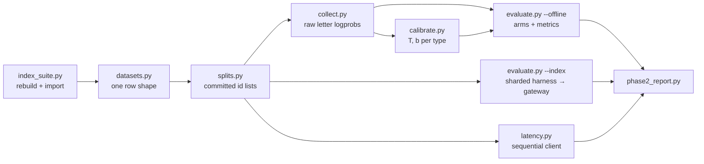

# Phase 2 design: calibrate and evaluate (DS-002)

Date: 2026-09-30. Status: approved in brainstorming, pending spec review.
Ticket: DS-002. Background: [calibration.md](../../background/calibration.md),
[noul-bias.md](../../background/noul-bias.md), [benchmarks.md](../../background/benchmarks.md),
[3-leaderboard.md](../../3-leaderboard.md), [ordering-and-layout.md](../../appendix/ordering-and-layout.md).

## Goal

Put our `/v1/systemone` numbers next to Jev and the open entries on the Decision Index
board, fit our own calibration, and settle the option-order and layout defaults with data.

Phase 2 is done when, for each profile:

- the Decision Index score, ECE and latency (latency-v1 design) are reported next to the
  matching board entries;
- a fitted, stamped `calibration.json` is committed;
- the option-order and layout experiment reports are committed, each with a recommendation;
- any default change is justified by an accuracy or ECE gain on held-out rows.

## Decisions

| Topic | Decision | Why |
|---|---|---|
| Structure | One spec, three milestones (M1 evaluate, M2 calibrate, M3 experiments), one plan per milestone | M2 and M3 reuse M1's data pipeline; one design keeps the interfaces consistent |
| Data flow | **Collect raw letter logprobs once, evaluate offline.** Live runs only for full Index runs, latency and a live-vs-offline spot check | One collection pass per profile replaces dozens of gateway configs and restarts; T and b need raw logprobs, which the API does not return (it returns post-T probabilities rounded to 4 decimals) |
| Index runs | Upstream harness `apolinario/decision-index` at commit `87d4650`, `--engine http` against the gateway, unchanged, sharded across processes | Keeps the result file and scoring board-clean. The harness is serial (one `for row` loop), so sharding is the only way to run a full suite in hours |
| Compute | Experiments on a fixed stratified Index dev sample (~8k rows) plus the extra sets; full Index only for the baseline and final config per profile (~6 runs) | A full run is ~150k requests |
| Long runs | **Every long run waits for an explicit ok from the owner**, with an estimate of time, GPU and disk | One GPU; runs block it for hours |
| Calibration data | Extra sets only (JevBench gold, filtered DecisionBench), split 50/50 calib/eval. The Index is never used for fitting | Index rows are upstream test rows; its ECE becomes an honest transfer test |
| Calibration form | Temperature per type, plus an optional noul offset `b` (Platt); stamped file, refused when stale | T can't fix the noul lean; b ships only if it wins on held-out rows |
| Jev outputs | Never read by collect, calibrate or evaluate | TypeSafe's terms |

## Architecture



### New and changed files

```
scripts/
  index_suite.py    pinned harness venv in .cache/decision-index-venv; suite rebuild + import
                    into .cache/decision-index/ (HF token from secrets/.hf-token)
  datasets.py       loaders: Index suite, JevBench gold, DecisionBench → decision rows
  splits.py         writes data/splits/*.json (calib, eval, index-dev, latency)
  collect.py        raw letter logprobs per (row, question, layout, order) → .cache/collect/
  calibrate.py      fits T (+ noul b) → data/<profile>/<layout>/calibration.json
  evaluate.py       --index: sharded harness run + merge + upstream score
                    --offline: arms from collected logprobs → metrics
  metrics.py        accuracy, ECE, NLL, Brier, noul bias, bootstrap CIs (shared with bench_report)
  latency.py        latency-v1 design run against the gateway
  phase2_report.py  tables vs board entries → docs/results/phase2/
gateway/
  decide.py         split into read_rows() (render → build → readout → raw logprobs) and
                    finish() (softmax → average_back → answer); decide() = both
  calibration.py    v2 file: per-type {T, b}, stamp check; noul offset in softmax
data/splits/        committed split id lists
```

Each script stays a small tutorial-style module; shared math lives in `metrics.py`, never
duplicated between `bench_report.py`, `calibrate.py` and `evaluate.py`.

### The decision row

Every source loads into one shape, so collect, calibrate and evaluate never branch on source:

```python
{"id": "jevbench:panoramic:invoices:17", "source": "jevbench", "family": "invoices",
 "state": ..., "questions": {qid: {...Jev question...}}, "gold": {qid: option_key | level | bool}}
```

Index rows keep their harness `id`, `family` (track) and `expected`; `metadata` stays
available for the per-benchmark breakdown but is never sent to the model.

## Data and splits

| Set | Rows used | Role |
|---|---|---|
| Decision Index 0.2.1 | all ~150k (120,340 + 30,419 added) | **eval only.** Full runs for baseline and final; a dev sample of ~8k for experiments |
| JevBench gold, pinned `fcec62f` | 1,682 | 50/50 calib/eval by id hash, stratified by source + type |
| DecisionBench, pinned dataset sha | canonical public-gold rows, after the filters below | 50/50 calib/eval by id hash, stratified by `task_id`. The 1,200-row reasoning track is eval only |
| LocalLLaMA/typed-decisions | none | Labels are a ~4B teacher's soft distributions, not gold. Its gold-tier rows reach us through JevBench |

- **DecisionBench filters:**
  - drop the 2.7k rows synthesised by Qwen3.8-27B-NVFP4 (the same family as one of our profiles);
  - drop rows whose `source_json` licence is "No license declared", "MIT with additional
    rider" or Functional Source License;
  - drop the sources that are also Index benchmarks (BANKING77, CLINC-OOS, Amazon ESCI).

  The dataset's own licence is `other` with no terms. It is used locally only and never
  redistributed, and the split files hold ids only.
- **Dedupe:** rows are keyed by a hash of the normalised state. A key seen in more than one
  set keeps one copy, and any key that appears in the Index is forced into eval.
- **Index dev sample:** ~8k rows, systematic over the suite sorted by benchmark then payload
  length (fixed seed), so every benchmark and length range is present. Linked cases
  (ToolRet/BRIGHT chunks, ACOS reviews) are sampled whole.
- **Latency sample:** the latency-v1 design: 10 warm-up and 750 timed rows, systematic over
  the same sort, seed `20260926`, with the published per-benchmark counts. The board's own
  sample is private, so ours has the same design but not the same rows; reports say so.
- **Split files** (`data/splits/*.json`) are committed with the source revisions they were
  cut from, so every fit and score can be reproduced.

## Collection

`collect.py --profile P --split S` runs on the host against vLLM on `127.0.0.1:8000` (the stack
up, the gateway idle). It builds a gateway `Engine` from the profile, exactly as the gateway's
startup does (tokenizer, all three layouts, labels, the profile's padding and warm-up settings),
and calls `read_rows()` for each row.

- **Orders per question:** identity, reversed, and the union of the `cyclic:2`, `cyclic:3`
  and `cyclic:4` shifts (≤ 7 distinct orders).
- **Layouts:** all three per row, through the existing per-request layout support. No restart
  is needed.
- **Output:** one jsonl.gz record per (row, layout) with each question's
  `[{perm, logprobs}]`, the prompt token counts and the stamp (profile, HF revision, layout
  sha, tokenizer sha, padding). The file is resumable and keyed by row id.
- **Unsupported rows** (longer than `MAX_MODEL_LEN` = 32,768, or over a capacity limit) are
  recorded as unsupported, exactly as the gateway would refuse them, and count as wrong.
- **Offline equals live by construction:** `finish()` is the gateway's own code path. A live
  spot check on ~200 rows must agree within the bf16 tolerance used by `test_stability`
  (0.05, with the top answer holding when the top-two gap > 0.10).

## Calibration (M2)

- **Fit unit:** (profile, layout, type), fitted on the calib split's raw logprobs under the
  order setting that will ship. If M3 changes the default order, the fit reruns.
- **Model:**
  - `p = softmax(lp / T)` for `choice` and `score`.
  - For `noul`, `p(yes) = σ(Δ/T + b)`. The offset belongs to the *word* "yes", not to a
    position, so it is added per order before `average_back`.
- **Fit:** minimise NLL. T is a bounded search on log T ∈ [0.05, 20]; noul does a 2-D search
  over (T, b). numpy only.
- **Shipping b:** b ≠ 0 ships only if a paired bootstrap (95% CI, 2,000 resamples) on the
  **eval** split shows an accuracy or ECE gain, without a loss in the other beyond its CI.
  Otherwise b = 0.
- **Shipping T (owner's per-type gate, 2026-10-02):** per type, the fitted T ships if the
  eval split's paired bootstrap of the ECE change vs T = 1 has CI low ≤ 0. Else, for noul with b shipping, the noul T fitted with b = 0 (b dropped) ships under the same
  test; else the pooled T (one T fitted on all types, b = 0); else T = 1.0. A T can ship
  with a worse point ECE when the CI includes 0 (qwen3.6 `decider_chat` score).
- **File (v2):** `format` is the schema marker the gateway checks (v1 has none and is
  refused). `version`, `date` and `comments` are informational only: refit count, UTC time
  of the latest fit, and one history entry per fit.

  ```json
  {"format": 2,
   "version": 3,
   "date": "2026-10-02T15:10:00Z",
   "comments": [{"version": 1, "date": "…", "text": "…"}],
   "stamp": {"tokenizer_sha256": "…", "layout_sha256": "…", "hf_revision": "…",
             "prefix_pad": "front", "prefix_block": 784},
   "types": {"choice": {"T": 1.31}, "score": {"T": 1.62}, "noul": {"T": 0.94, "b": 0.0}},
   "fit": {"split": "data/splits/calib.json", "split_sha256": "…", "orders": "identity",
           "n": {"choice": 0, "score": 0, "noul": 0},
           "calib": {"nll": {"before": {}, "after": {}}, "ece": {"before": {}, "after": {}}},
           "eval": {"nll": {"before": {}, "after": {}}, "ece": {"before": {}, "after": {}}},
           "b_decision": {}, "t_decision": {}}}
  ```

- **Gateway:**
  - a stamp mismatch, or a v1 or unstamped file, refuses startup with a message naming the
    field, as `labels.json` does;
  - a missing file keeps today's behaviour (warning, T = 1, b = 0);
  - the borrowed decider file (`T = 1.943`) is replaced by our own fit in M2.

## Experiments (M3)

All arms are computed offline from the collected logprobs, on the Index dev sample plus the
extra sets' eval split. Every comparison is paired, on the same rows, with bootstrap CIs.

### Option order

- **Arms:**
  - `identity`, `identity+reversed`, `cyclic:2`, `cyclic:3`, `cyclic:4`;
  - **PriDe** (Zheng et al. 2023): estimate a per-position prior from a 5% slice using the
    cyclic reads, then divide it out of identity-only reads. Debiased with no extra reads
    at serve time.
- **Metrics:**
  - accuracy, ECE, NLL;
  - flip rate (the top answer changes between identity and reversed);
  - a histogram of chosen position vs gold position;
  - AUROC of the disagreement between orders (TVD) as a predictor of errors.

  Reported per type and per option-count bucket (2, 3–5, 6–26, 27+).
- **Noul:** identity vs reversed separates a lean to position A from a lean to the word "no".
- **Cost:** k orders mean k reads per question. The winning arm's latency is measured live on
  the latency sample.

### Layout

- `decider_chat`, `header` and `question_first`, each with its own fitted T.
- Reported by type and by state-length bucket (<512, 512–2k, 2k–8k, >8k tokens), plus a long-
  document slice:
  - JevBench invoices;
  - Index ContractNLI, NLI4CT and BRIGHT;
  - DecisionBench rows over 2k tokens.
- Latency per layout is measured live on the latency sample with the per-request `layout`
  field.
- An auto-switch rule is allowed only where a bucket's winner differs with a CI clear of zero.

### Changing a default

A default (`OPTION_ORDERS`, `PROMPT_LAYOUT`, b) changes only on a paired-bootstrap gain in
accuracy or ECE on held-out rows, with the latency cost stated, and is then confirmed by
the final full Index run. Prompt wording is out of scope: it would mean rebuilding the label
tables and refitting.

## Index runs and latency

- **`evaluate.py --index`:**
  - splits the suite into N shards (default 8) and runs one harness `run` per shard, each
    with its own `--out`;
  - merges the `results.jsonl` files and runs upstream `score --edition 0.2.1`;
  - resumes per shard, as the harness does.

  The gateway is unchanged apart from the profile's settings. The harness's capacity markers
  already appear in our 422 messages ([schema.py](../../../gateway/schema.py)); M1 adds a
  test that each of our refusal messages contains one.
- **Board comparison:** the Index, the area scores, ECE and coverage (unsupported rows).
  - ECE uses the board's method if upstream `score` emits it. Otherwise `metrics.py` computes
    it over the same benchmark set as the board's `calibration` block (32 benchmarks); M1
    confirms which, and the report says so.
  - Each number sits next to the matching board entries:
    - Decider chat · Qwen3.6-27B (51.35), against our qwen3.6-27b on `decider_chat`;
    - Decider chat · Gemma-4-31B (57.33), against gemma-4-31b;
    - simple-jev (55.7), reflex (52.2) and Jevfire (49.4), all on Qwen3.8-27B, against
      qwen3.8-27b;
    - Jev (57.9).
- **Parity gate (M1):** qwen3.6-27b on `decider_chat` with decider's T should land within
  ±1.5 Index points of 51.35. Our prompt matches decider's token for token, so a bigger gap
  is a bug to ticket before M2.
- **Decision length cap (M1):**
  - Count Index rows by prompt length from the suite's `proxy_tokens`, then by real token
    count for the rows near the cap.
  - Score the long rows twice: at the 32k decision cap, and at the profile's full
    `MAX_MODEL_LEN`.
  - Report the Index gain against the cost: latency of the long rows, KV peak, and chat
    ITL while they run.
  - Recommend a `SYSTEMONE_MAX_LEN` per profile. Changing it needs the owner's decision,
    because long decisions compete with coding agents for KV and prefill.
- **`latency.py`:** one sequential client, 10 warm-up rows, then 750 timed rows. Reports the
  median and p95 overall and per benchmark (≥5 rows), plus the board's figures beside them.

## Milestones

| Milestone | Deliverables | Gate |
|---|---|---|
| **M1 evaluate** | `index_suite`, `datasets`, `splits`, `metrics`, the `read_rows`/`finish` seam, `collect`, `evaluate`, `latency`; a baseline full Index and latency run per profile; the decision length-cap comparison | parity gate passes; offline matches live on the spot check |
| **M2 calibrate** | `calibrate.py`, the v2 `calibration.json` with the gateway stamp check and noul offset, fits for 3 profiles × 3 layouts | owner's per-type gate (fitted T ships if its eval ECE-change CI low ≤ 0 vs T = 1, else (noul with b only) its b = 0 T, else pooled T, each on the same test, else 1.0; a T may ship with worse point ECE when the CI includes 0); Index ECE reported as a transfer result |
| **M3 experiments** | order and layout reports with recommendations, a final full Index per profile, `phase2_report.py`, the README table | DS-002's verify criteria |

### Long runs (each needs the owner's explicit ok)

| Run | Estimate (to confirm in M1) |
|---|---|
| Suite rebuild | ~7 GB download, 17 GB scratch, ~1 h |
| Collect, per profile | ~11k rows × 3 layouts × ≤7 orders, 2–4 h |
| Full Index, per profile and config | ~150k requests over 8 shards, 1–2 h |
| Latency, per profile and arm | ~5 min |
| Profile switch | stack restart, 4–10 min |

## Testing

TDD for every new module. CPU-only unit tests unless marked live.

- **Splits:** deterministic, disjoint, and stratified as specified; Index-overlapping keys
  forced into eval.
- **Loaders:** tiny fixture rows per source map to the decision-row shape.
- **`read_rows()` + `finish()` equals `decide()`:** the existing decide tests stay green.
- **Calibration:** the fit recovers a known T and b from synthetic logprobs; stale, v1 and
  unstamped files are refused; the noul offset is applied per order before averaging.
- **Metrics:** ECE, NLL and Brier against hand-worked examples (the ones in calibration.md);
  `bench_report` uses the shared module.
- **Harness:** shard and merge round-trip; every gateway refusal message carries a harness
  marker.
- **Latency:** sample selection is deterministic for the seed.
- **Live** (`pytest -m live`): offline answers equal live gateway answers on a small sample.

## Risks and follow-ups

- **Context limit:** decisions are capped by `SYSTEMONE_MAX_LEN` (DS-018, default 32,768),
  separate from vLLM's `MAX_MODEL_LEN`. The model limit rises for coding agents: 262,144 on
  Qwen (DS-016), 131,072 on Gemma (DS-017). Index rows above the decision cap count as
  unanswered. Answer quality on long decisions is unmeasured.
- **T may not transfer:** Jev's refit T ranged from 0.96 to 2.7 across datasets. The Index
  ECE shows how far ours moves; we report it and do not tune T on the Index.
- **DecisionBench licence ambiguity:** recorded in the report; local use only.
- **New issues** found during the work are filed as DoStuff tickets and pulled into the
  sprint.
